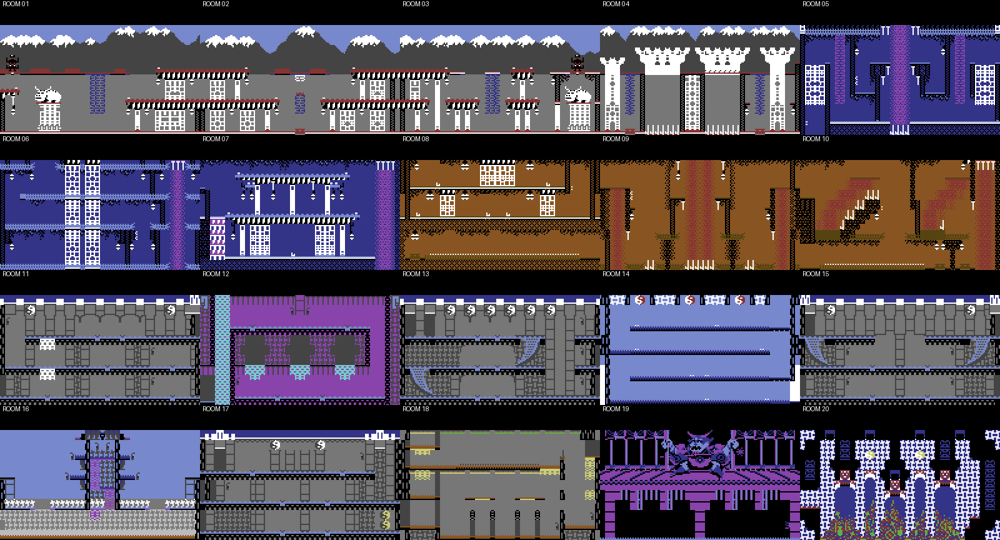

# Bruce for Amiga

**Bruce** brings the rooms and fighting of the Commodore 64 game *Bruce Lee* to the Amiga. It includes **Classic** graphics and an optional **Enhanced** presentation, with a shared game engine.

[Download the release candidate](https://github.com/tonnyrh/AmigaBruce/releases) · [Active tests](docs/ACTIVE_TESTS.md) · [Project plan](docs/PROJECT_PLAN.md)


## Classic and Enhanced

- **Classic** uses extracted C64 character graphics and sprites, with source-driven music and sound effects adapted to Paula.
- **Enhanced** adds new fighters, scenery, animation artwork and short combat samples. Select it with **F4** on the main menu.
- Both modes use the same reconstructed movement, combat, enemy AI and progression. Enhanced artwork does not define collision geometry.
- All **20 rooms** use decoded C64 room data and translated room routines.
- The main menu includes player count, Yamo control and optional test settings. **P** pauses both gameplay and sound.


This is a work in progress. Source comparisons and controlled tests support individual rules; they do not certify complete original-game parity or a complete natural playthrough. The frozen Remember/T64 reference candidate has **not** been confirmed as the selected untouched 1984 release.

## Playing

The target configuration is a **PAL Amiga 500, 68000, OCS, Kickstart 1.3, 512 KiB Chip RAM and 512 KiB expansion RAM**. The release page provides a bootable ADF and a package containing the Amiga executable and instructions. Kickstart ROMs and emulator software are not included.

For WinUAE, use the target configuration above. Mix all three audio voices to both outputs if you listen through only one speaker or channel. See the [audio setup notes](docs/AUDIO_PLAYBACK.md).

### Controls

| Control | Action |
| --- | --- |
| Joystick | Move; up jumps or climbs when the source rules permit |
| Fire 0 / primary button | Attack; confirm a selected room |
| Fire 1 / second button | Same input as up: jump or climb |
| P | Pause / resume |
| F10 | Main menu during ordinary play |
| Esc | Exit to AmigaDOS |

On the main menu, **F3** changes the player count, **F5** changes Yamo control, and **F4** switches between Classic and Enhanced. Fire or Return starts the game, except that room selection requires the primary Fire button.

### Test options

Press **Shift+D** on the main menu to open test options:

| Key | Option |
| --- | --- |
| F1 | Infinite falls |
| F2 | Invincibility |
| F3 | Enable room selection |
| F9 / F10 | Previous / next room |
| F5 | Back to the main menu |

With room selection enabled, **F9/F10** browse rooms during play and **F8** opens the main menu. Browsing pauses the game; press **Fire 0** to enter the selected room and start its normal enemy timers. Earlier rooms' lanterns are marked as collected for this test route. It is not a normal progression playthrough. See [room selection and saved progress](docs/CHEAT_PROGRESS.md).

## Building and testing

The Windows build uses PowerShell, Python 3.10+ with Pillow, and the toolchain bundled with the BartmanAbyss Amiga Debug VS Code extension. Some extraction and reference checks also require the local frozen C64 reference files, which are not distributed in this repository.

```powershell
.\amiga-build.ps1
.\amiga-run.ps1
```

The build produces `amiga/out/bruce_amiga.exe` and `amiga/out/bruce_amiga.adf`. The run script configures WinUAE; supply your own Kickstart ROM. Start a new game when testing a new build: old `.uss` saves contain the old program.

Useful validation entry points:

```powershell
.\test-parity.ps1
.\test-source-world.ps1
.\test-enhanced-audio.ps1
```

These checks have different scopes. Source comparisons check documented interpretations against the frozen binary. Native tests check the Amiga implementation. Neither replaces natural playtesting, listening tests or physical-machine acceptance. [Validation method](docs/parity/README.md) · [Current performance evidence](docs/OP_A500_ACCEPTANCE.md).

## Graphics editor

Launch [GraphicsEditor.cmd](GraphicsEditor.cmd) to edit Enhanced fighters and scenery. The editor provides pixel editing, previews, PNG import/export, AI suggestion support, graphics packing and Amiga builds. Its interface and tool messages are in English.

[Graphics editor guide](docs/GRAPHICS_EDITOR.md) · [Enhanced graphics and audio](docs/ENHANCED.md) · [Artwork pipeline](docs/AMIGA_ART_PIPELINE.md).

## Reconstruction and evidence

Game rules are derived from the frozen C64 binary, its tables and documented disassembly. Uncertain behavior stays open until the relevant branches are traced. A browser reconstruction or a newly invented collision model is not treated as evidence of C64 behavior.

- [Room reconstruction](docs/ROOM_RECONSTRUCTION.md)
- [Source engine integration and milestone status](docs/MILESTONE_COMPLETION.md)
- [Movement](docs/C64_MOVEMENT.md), [climbing](docs/C64_CLIMB.md), [lanterns and room boundaries](docs/C64_CONTACTS.md)
- [Enemy AI](docs/C64_AI.md), [enemy spawning](docs/ENEMY_SPAWNS.md), [wall contact](docs/NINJA_WALL.md)
- [Bombs and enemy entry](docs/BOMBS_ENTRY.md), [death, lives and menus](docs/SESSION_WALLS.md)
- [Extracted sprites](docs/C64_SPRITES.md), [source audio](docs/SOURCE_AUDIO.md), [Paula playback](docs/PAULA_STREAM.md)
- [Earlier T01–T18 test review](docs/TEST_AUDIT_2026-10-25.md)
- [Source register](docs/reference/SOURCES.md), [parity register](docs/parity/register.csv), [room register](docs/parity/rooms.csv)
- [Project rules](AGENTS.md)

Some detailed development documents remain in Norwegian. Dated measurements describe their recorded builds, not automatically the current release. The [active test list](docs/ACTIVE_TESTS.md) records outstanding timing, rendering, sound and gameplay acceptance work.



Original disk images, snapshots, ROMs and local upstream checkouts are kept outside the published source under ignored reference directories. The separate extracted room and sprite assets in `assets/c64/rooms-v1/` and `assets/c64/sprites-v1/` record their source addresses and hashes. Enhanced asset folders retain generation and conversion metadata.

The name *Bruce Lee* is retained when referring to the C64 original and in existing reference filenames. The Amiga game is named **Bruce**. Bruce Lee II is not included.
