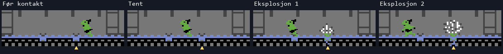

# Fiendeinnganger og bomber

26. oktober2026. Frossen kilde er Remember/T64-kandidaten
`.reference/c64/work/untrained-memory.bin`, SHA256
`092c50dbc997e301c75c7860a3c84026a93a7aaf543968ae36f1ffa19d0800b8`.
Den er ikke sertifisert som urørt1984-utgave. Originalene er uendret.

## Fiendene har flere inngangspunkter

`$0BFA–$0C4B` velger mellom standardpunktet `$4BAE/$4BC2`, alternativet
`$4BD6/$4BEA` og lagrede koordinater/helse `$8A/$8C/$8E+aktør`.
Yamo tester `$136F`; Kage tester `$1333`, men fortegnsvalget ved `$0C38`
leser faktisk `$136F`. Det er beholdt. `$1159` leser kilde-RAM; ingen ny
myntkastregel eller uniform fordeling er lagt til.

Rom6 har standard `(44,81)` og alternativ `(56,194)`. Begge fiender kan
bruke punktet oppe ved Bruce. Rom7 har `(244,179)` og `(234,114)`, og rom8
har `(32,68)` og `(38,116)`. Valg finnes også i de øvrige rommenes tabeller;
en tabelloppføring betyr ikke at fiender naturlig er aktivert i alle rom.

Porten kjører nå den statisk oversatte `$0BFA`-rutinen, inkludert de
opprinnelige minneavlesningene. Det ekstra, faste NPC-punktet som tidligere
overskrev den valgte plasseringen på slutten av Amiga-stegene er fjernet.
Ved vanlig rombytte lagres aktive fienders helse og Bruces destinasjon
slik `$2FA5–$2FBD` gjør. Lagret inngang brukes én gang og tømmes av kildekoden.
Helse begrenses deretter som i `$0D04/$0E0D`.
Etter overlevd livstap nullstilles de lagrede X-flaggene`$8B/$8C`, slik
`$1832–$1836` gjør; dette kontrolleres også i dødsfixturene.

Full IRQ, minneavlesningsrekkefølge, inngangsanimasjoner og ordinær
spawn-/ventetjeneste er fortsatt delvise adaptere. Dette er ikke en påstand
om identisk naturlig valgfordeling eller full NPC-paritet.

## Fiender utløser bomber

### Rom 11 når Yamo går over bomben

Kontrollert 31. oktober 2026 mot kandidaten med SHA-256 øverst i dokumentet.
Rom 11 har sju bomber. Kolonne og objektrad er henholdsvis (19, 6), (24, 6),
(21, 9), (34, 9), (9, 12), (21, 12) og (34, 12). Romrutinen hopper fra
`$3CBD` til `$3228` før figurenes kontakt beregnes ved `$1C0D → $5212`.
En aktiv Yamo i gangtilstand kan tenne en bombe. Objektpasset velger aktør
1, leser kontaktbiten fra `$B7` og undersøker cellene under kroppsmasken.
Ved treff på `$60` går det til `$306B`. En allerede tent bombe eller tre
opptatte tidsregistre gir ingen ny tenning.

Det synlige signalet kommer først ved eksplosjonen. I rom 11 er øverste
bombetegn `$60` i tegnsettet ved `$A800`. Radene er
`82 82 69 69 55 55 55 55`. Ingen av pikselparene bruker individuell
tegnfarge (bitpar 11). Tenning skriver `$FD` over `$F8` for dette ene
tegnet ved `$30CA`. Nedre tegn `$E0` beholder fargen. Bombens piksler
forblir dermed identiske mens Yamo går videre. Åtte spillsteg etter tenning
tegner `$323D–$325A` første eksplosjon. Ved gammel teller 20 setter
`$328A–$32B5` grafikk og farge tilbake.

`python tools/audit_r11_yamo_walk.py` kjøres etter `./test-c64-actors.ps1 -CompileOnly`.
Kontrollen bruker styrte startplasseringer, går fra begge sider på alle
sju bomber og kjører både med AI og med Yamos joystick. I 28 av 28 forsøk
reserverte aktør 1 tidsregisteret, og eksplosjonstegnene dukket opp 24
modellerte PAL-felt senere. Hele kilde-RAM stemte med vertsbygget av
spillmotoren etter hvert felt og hvert hovedsteg. Dette er kontrollert
kjøring av kandidatens maskinkode med modellert VIC-kontakt og feltgrense.

I det ordinære WinUAE-bygget (EXE SHA-256
`88dc94012e801d56e80fcaed767a5d158bab451ed10b6902ca97ae9df0d31528`)
ble rommet åpnet med testmenyen. Bruce stod stille på mellomnivået mens
Yamo kom fra høyre på øverste avsats og passerte bomben i kolonne 24.
Ingen figurposisjoner eller tidsregistre ble skrevet av testen. Ved
spillsteg 417 var telleren 6 og bomben så ut som før. Ved steg 423 og
426 viste den aktive skjermbufferen begge eksplosjonsformene. Alle 768
piksler i utsnittet på 24 × 32 piksler stemte med kildebildet ved hvert
av de tre stegene. Den gule markøren under utsnittet viser bombens plass.

Brukerens konkrete passering der eksplosjonen uteble står åpen i
[testlisten](ACTIVE_TESTS.md). Et lagringspunkt før kontakt kan vise om
bomben var ledig, om Yamo fikk kontakt, og hva som faktisk ble tegnet.

### Intermittent contacts reported in Enhanced, 9 November 2026

The new report concerns the middle platform in room 11 and may also affect
Bruce and Kage. It remains open. The current normal ADF was tested in
cycle-exact PAL A500 WinUAE with 512 KiB Chip and 512 KiB slow RAM.

Controlled Yamo walks triggered both middle-platform bombs, at columns 21
and 34, in Classic and Enhanced. Three walking routes in each mode showed
both blast shapes and the restored floor. The 24 × 32 background regions
matched the corresponding source pixels or Enhanced artwork. An additional
rightward approach to column 34 changed into a flying kick before the bomb
and stopped near Bruce, so it does not establish a completed walking crossing.
The initial positions were set in the debugger. These are controlled tests,
not a replay of the user's physical-Amiga session.

There is a source-defined reason why a contact can sometimes be ignored.
`$307A–$30B3` checks only three global timers, `$4FDE–$4FE0`. When all are
occupied, `$30B3` branches directly to `$30CC` without setting the new
bomb's attribute or remembering the contact. The first visible blast is
delayed until old counter 8. Old counter 20 restores the graphic, while
the timer remains occupied until old counter 24. Thus neither a quiet bomb
nor a restored floor proves that a timer is available.

`python tools/audit_bomb_capacity.py`, after `test-c64-actors.ps1 -CompileOnly`,
compares all source RAM against the actual candidate instructions for
Bruce, Yamo and Kage on both middle bombs with every occupied-slot
combination. All 48 contact cases and 1,152 timer calls matched, including
release and attribute restoration. A separate controlled native Enhanced
test occupied all three timers. Bruce's contact was ignored while they
were busy, then armed the middle bomb and produced the explosion after
they were released. This confirms that boundary in the current ADF, but
does not establish the cause of the user's intermittent case.

No game rules or executable were changed for this investigation.
[Native traces and source evidence](../reference/analysis/r11-yamo-enhanced-2026-11-09/report.json)
and [the two middle bombs in Enhanced](../reference/analysis/r11-yamo-enhanced-2026-11-09/middle-bombs.png).

### Bomb contact at an object-row boundary, 9 November 2026

The follow-up report includes Bruce walking over bombs in several rooms.
There is a second, source-derived explanation independent of timer capacity:
pixel contact and the object search must agree during the same game step.

`$5212–$52AC` calculates contact classes from the original pose-mask pointers
at `$1167/$1239` and the room glyph pixels. The bomb path requires bit 1
of `$B6+actor`. Enhanced artwork is not an input to this calculation.
`$2E39–$2E88` then searches three columns in two object rows for each active
actor, excluding death state 25. `$1C39–$1C5A` derives the first row from
`(source_y - 12) >> 4`, using byte arithmetic. The next row is first + 1.
Room 14 has a separate +4 adjustment; it is outside the bomb controls here.
Finding `$60` with the contact bit enabled leads to `$306B`, which still
requires an unarmed attribute and a free timer.

For the room 11 middle bomb at column 21, object row 9, a controlled Bruce
walk from the right demonstrates the boundary:

| Initial source Y | Rows searched during contact | Result |
| --- | --- | --- |
| 139 | 7 and 8 | Contact mask becomes 3, but bomb row 9 is excluded. No timer starts. |
| 140 | 8 and 9 | Contact mask becomes 3 and the bomb arms, then explodes. |

In the first walk Bruce subsequently drops to Y140, but by then the contact
mask has lost the hazard bit. Searching the correct row at that later time
does not recover the missed contact. All three bomb timers started free in
both controls. This therefore establishes a missed-contact mechanism, not
only the separate three-timer limit described above.

`python tools/audit_bomb_walk_contacts.py`, after
`test-c64-actors.ps1 -CompileOnly`, checks paired starting heights for all
27 bombs in rooms 11, 12, 13, 15 and 17. All 54 leftward walks matched the
actual frozen 6502 instructions at all 3,472 full-RAM comparison boundaries
(5,027,178 instructions executed). The starts are injected; the subsequent
walking uses normal input. Field scheduling and VIC inputs are modeled,
so this is not a raster-exact or natural C64 playthrough.

The unchanged normal ADF reproduces both room 11 outcomes in Classic and
Enhanced on cycle-exact PAL A500 WinUAE, 512 KiB Chip + 512 KiB slow RAM.
Native controls inject the starting position, disable the enemies, then
use normal left joystick input. They do not force contact masks or timers.
All four controls passed. This is not a replay of the physical-Amiga report.

The shared source routine applies to all actors; these new walking controls
specifically exercise Bruce. How often normal play reaches the missed-contact
height, and whether it explains every reported enemy or Bruce crossing,
remain open. No hitbox, source rule, graphics or executable was changed.
The source remains the unverified Remember/T64 candidate identified above.
[Traces, build identities and disassembly](../reference/analysis/bomb-contact-2026-11-09/report.json).

### Explicit Amiga bomb margin, user decision 9 November 2026

After confirming missed crossings on both WinUAE and a physical Amiga, the
user requested a more forgiving bomb contact. This is an intentional exception
to strict C64 parity, enabled in normal Classic and Enhanced games.

The original object pass still runs first. For an active, non-dying actor,
a supplemental pass checks only live, unarmed `$60` charges against the
original pose mask. It expands the charge's class-2 pixels by one display
pixel upward and one to either side, including the upper corners. It does
not expand downward. This bomb-only check also bypasses the coarse object-row
rejection that lost the Y139 crossing; it does not change the source contact
bits, actor position, wall collision, melee hitboxes or explosion damage area.

Allocation retains `$306B–$30D3`: first free slot among `$4FDE–$4FE0`, column
and object row minus one, attribute `$FD`. Already armed charges, inactive
actors and death state 25 cannot re-arm a charge. The source's three-slot
limit and explosion timing remain. A charge can still be ignored when all
three slots are occupied; this change does not introduce a waiting queue.

`bl_c64_set_bomb_contact_margin(1)` explicitly enables the policy in the
normal Amiga UI. It survives source room/life resets. Source-only comparison
fixtures and the older native parity harness leave it disabled; they must
not be presented as tests of the added policy. The separate
`tools/verify_bomb_margin.py` enables it and checks 8,424 contacts against an
independent pixel-set oracle for Bruce, Yamo and Kage, covering both charge
glyph banks. This includes 1,080 contacts introduced solely by the pixel
margin. All 54 paired-height walking controls now arm their target bomb.
Fifteen additional controls cover disabling, death, capacity and repeat
contacts. Rooms without charges skip the supplemental scan, using presence
recorded from source screen bytes, independently of the artwork.

Enhanced charges now have a rounded upper casing and a flat base at the
platform lip. The floor continues immediately below; there is no rounded
lower half. This applies to both gallery and vault art in
`tools/enhanced_bombs.py`. Classic graphics and both explosion drawings are
unchanged. [Margin controls](../reference/analysis/bomb-margin-2026-11-09/host.json).

The final normal ADF passed four controlled room 11 walks in cycle-exact
WinUAE (Classic/Enhanced, starting Y139/Y140). All four armed and exploded
without injected contacts or timers. Twelve idle charge regions in rooms 8
and 11 matched all 9,216 expected pixels, including the continuing floor.
The source-only regression also passed 3,034 actor-chain controls and 48
bomb-capacity cases with 1,152 timer calls, with the margin disabled as
documented above. EXE size is 377,296 bytes; ADF size is 901,120 bytes.
[Final build and native evidence](../reference/analysis/bomb-margin-2026-11-09/report.json)
and [actual WinUAE charge crops](../reference/analysis/bomb-margin-2026-11-09/charges.png).
The physical-Amiga retest remains open.

### Felles rutiner

`$2E39–$2E6D` behandler Kage, Yamo og Bruce i den rekkefølgen; bare
dødstilstand25 og inaktive aktører utelates. Objektkontaktbiten `$B6,X & 2` gjelder de
seks skannede cellene. Bombetegn`$60` går via `$2EF7` til `$306B`, uten
en test som begrenser utløsning til Bruce.

`$306B–$30D3` krever fargeklasse ulik5, reserverer den første ledige av tre
poster `$4FDE..$4FE0`, lagrer kolonne/rad minus1 og setter attributt`$FD`.
Amiga sjekket tidligere bare dette for Bruce. NPC-passet gjør nå også dette.

`$3228–$32CB` bruker gammel tellerverdi ved fasevalget:8 gir eksplosjon og
effekt`$8D`,12 bytter form,16 går tilbake til første form,20 rydder bildet
og24 frigjør posten. Tegn`$71..$7C` er farlige under eksplosjonen.
Utløsning alene er altså ikke umiddelbar skade.

`$304B` sender farerammede NPC-er til `$3001`, fjerner dem og velger ny
returventing via `$0D42`. Native kode bruker nå denne faktiske grenen,
inkludert de selvmodifiserte tabelloperandene ved `$0D55/$0D85`.
En lokal tellekompensasjon hindrer Amiga-adapteren i å trekke den nye
returventingen allerede i samme steg som eksplosjonen fjerner fienden.

### Bombegrafikk i Enhanced

I den frosne C64-kandidaten peker tabellen ved `$43BE` på tegnstrengene ved
`$4612/$4616/$461A/$461E/$4622`. Rutinen ved `$3228` tegner den lille
eksplosjonen med `$71–$76` og den store med `$77–$7C`. Begge opptar
tre kolonner og to 8 × 16-celler. Ved teller 20 kommer gulvrekken
`$7D,$60,$7D` tilbake. `$306B` endrer bare øvre tegns fargeattributt
ved tenning. Ingen piksel i øvre `$60` bruker det endrede fargeparet i
de to bombetegnsettene.

Enhanced bruker egne pikseltegninger i `tools/enhanced_bombs.py` for
metalladningen og de to eksplosjonsformene. Tegningene følger gulvhøyden
i begge tegnbanker. Rom 7 og 8 bruker `$A000`. Rom 11, 12, 13, 15 og 17
bruker `$A800`. Fargene kommer fra spillets eksisterende OCS-palett.
Kollisjon og lyd styres fremdeles av spillmotorens bombeteller.

Den vanlige ADF-en ble startet i WinUAE med PAL OCS, Kickstart 1.3,
512 KiB Chip og 512 KiB utvidelse. I rom 8 og 11 ble en ledig bombeteller
startet i debuggeren. For hver fase ble de 24 × 32 pikslene i den viste
skjermbufferen sammenlignet med tegningen for den faktiske C64-tegnstrengen.
Etter smellet ble både gulvet og ladningen gjenopprettet i begge rom.
[Bildeutsnitt fra WinUAE](../reference/analysis/enhanced-bombs-2026-11-04/bombs.png)

### Gulvbombene i rom 12

Romstrømmen ved `$774C–$7842` i den samme kandidaten plasserer fire
ladninger som `$70,$60,$70`. Kolonnene er 10 og 29 på romrad 5,
og 15 og 24 på romrad 12. Gulvtegn `$70` og gjenopprettingstegn
`$7D` har identiske tegnrader i banken ved `$A800`.

I Enhanced begynner gulvleppen fire piksler under toppen av ladningens
celle. Den øvre halvdelen på 8 × 8 piksler har derfor et sammenhengende
lyst metallbånd over leppen og et lite lyspunkt på lunta. Denne tegningen
brukes også av bombene i rom 11, 13, 15 og 17 som deler samme tegnbank.

På PAL A500 i WinUAE (512 + 512 KiB) ble de to diskettutgavene
sammenlignet i rom 12. For hver av de fire ladningene startet prøven en
ledig bombeteller i debuggeren. Begge eksplosjonsbilder og det
gjenopprettede gulvet stemte med C64-tegnstrengen og de pakkede
Enhanced-flisene. [Rom 12 med utsnitt før og etter](../reference/analysis/room12-bombs-2026-11-04/room-12.png)

## Bruce skriker, står stille og mister et liv

`$3057` ber om effekt`$8C`; `$3068 → $407D` velger tilstand25/teller16.
`$216B–$217A` lar posisjonen stå stille og går til livsgrenen `$1818`
på siste aktøroppdatering. `$27B8` velger positur8. Lyden er den eksisterende
kildebaserte Paula-utgaven av denne effekten; ingen ny lyd er generert.
Portens livsadapter bruker fortsatt negativ helse som intern dødsmarkør;
kildevalget som sammenlignes her er BF25/CE16, positur og stillstand.
Dette erklærer ikke full helse-/HUD-paritet under dødssekvensen.

Grunnforløpet fantes allerede. To Amiga-avvik er rettet:

- Negativ kamphelse blokkerer ikke lenger objektpasset. C64 utelater
  tilstand25, ikke alle med negativ helse; en eksplosjon kan erstatte en
  pågående kampdød med tilstand25. Livstap telles bare én gang.
- En gammel veggretting24 får ikke overstyre dødsposituren. Dødsgrenen
  erstatter den, mens de fysiske koordinatene beholdes gjennom stillstanden.

Udødelighet i testmenyen undertrykker fortsatt død med hensikt. For vanlig
lytte-/dødstest må denne være av; uendelige liv lar dødssekvensen gå normalt.

### Enhanced death pose correction, 12 November 2026

The frozen candidate's `$27B8–$27BE` selects pose `$08` for death state
25, independent of facing. `$407D–$4085` sets state 25 and counter 16;
`$216B–$217C` holds position and reaches the life-loss branch on the last
update. The source identity and edition caveat at the top of this document
still apply.

Enhanced already contains the matching stiff `$08` silhouette in art slot
14. However, `enhanced_frame()` overrode that selection with slot 12 whenever
`source_state == 25`. Slot 12 is the directional hit reaction (`$2C/$2E`),
so the correct source death state was displayed with the wrong body pose.
The override is removed. The display now follows the source-selected pose;
no death timer, sound, life count, collision rule or Classic sprite changes.

`tools/check_death_pose.py` exercises bomb deaths from controlled initial
placements in the normal ADF, in both modes and both facings. It checks
published `$08` pixels during state 25, fixed coordinates, and one lost life.
Bomb arming, explosion and death state are not injected.
[Source disassembly and native verification](../reference/analysis/enhanced-death-2026-11-12/report.json).

## Kontroller

`test-bombs-entry.ps1` sammenligner640 inngangsvalg over20 rom med faktiske
6502-instruksjoner, inkludert minnegrensene191/192, begge utfall og lagrede
innganger. Tre aktørkontakter med en ekte bombe i rom7 sammenlignes med
`$2E39`; begge NPC-er kontrolleres også mot eksplosjonsfjerning.
Tre tidligere Bruce-tilstander sammenlignes gjennom16 dødsoppdateringer
hver.42 NPC-farekontroller dekker aktuelle bomberom og tid0/25/32.

44 utvalgte inngangs-, bombe-, døds- og integrasjonskontroller inngår også
i session-fixturen på verten og68000. Starttilstander og minneavlesningsdata
er injisert og merket; dette er ikke naturlig C64-gjennomspilling.

[Kildekontroller og disassembly](../reference/analysis/bombs-entry-2026-10-26/report.json).
Gjeldende bygg og native resultat bindes i
`reference/validation/bombs-entry-delivery.json` etter maskinkontrollen.

**Historisk måling for BOMBS-ENTRY-bygget.** Gjeldende kode, spawn-rekkefølge
og nye maskinkontroller beskrives i [spawn-leveransen](ENEMY_SPAWNS.md).

Maskinkontrollen er fullført: to A500-CLI-løp på6000 felt hver består
funksjonsportene, inkludert44 nye kontroller per løp og de tidligere
session-/vegg-/bevegelses-/nett-/lydkontrollene. Begge matcher vertens
kontrollerte kampresultat:62 treff,6 nedleggelser,10 fiendeinntredener og
2 Bruce-dødsfall/tilbakestillinger. OS gjenopprettes begge ganger.
Største sammenhengende Chip-blokk er60832 byte.967/963 felt er forsinket,
med maksimal avstand3 perioder; stabil feltkadens er fortsatt åpen.
Normal EXE er223036 byte, ADF901120, og `C:start` peker på normalbygget.

### Kontrollerte langtidskjøringer

Første to native løp bestod situasjonskontrollene, men den samlede
kampreplayen hadde62 treff mot vertens64. De ble avvist av sammenligningen;
rådata og EXE er bevart under `uncontrolled-read-diagnostic/` i analyseområdet.
Ingen forventning eller sammenligningsport ble senket for å godta dette.

Etter at `$0BFA` ble koblet inn, leser `$1159` også levende RAM som SID-
driveren endrer, blant annet`$F6..$FB`. Verten avspiller én lydoppdatering per
kontrollfelt, mens native avspilling følger faktiske maskinfelt og innhenter
forsinkelser. Disse er forskjellige inngangsdata til en minnebasert velger.

Den ordinære kampreplayen injiserer derfor nå samme høye lesebyte`$17=$68`
på begge plattformer, før replayen starter. Leseren bruker da kandidatens
uendrede spritebytes i`$6800`-området. Selve velgerkoden og den lave
pekertelleren kjøres fortsatt normalt. Rapporten oppgir`source_reader_page=104`,
og testporten krever denne verdien i tillegg til identiske kampresultater.
Dette gjelder bare kontrollreplayen; normalspill og rom-/dørinspeksjon får
ingen slik overstyring. De640 separate kildevalgene er fortsatt primærkontrollen
av inngangsreglene. Langtidsreplayen fastsetter ikke naturlig C64-valgfordeling.
