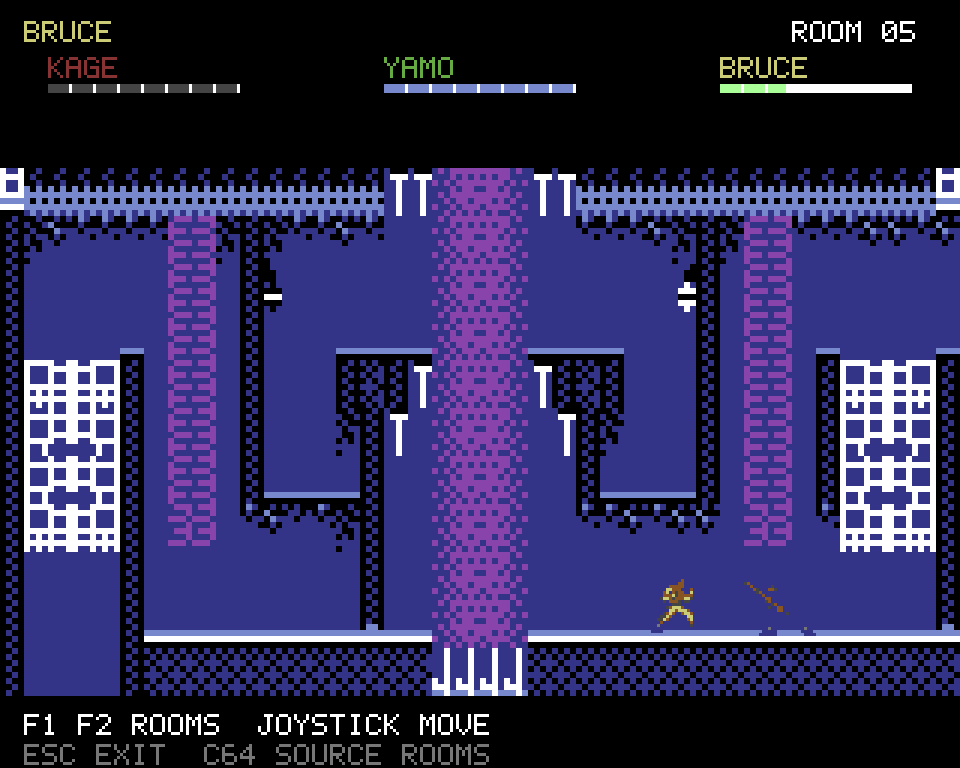

# Klatring: rom5 og sidefart

25. oktober2026. Klaterutinen og kontaktpositurene er korrigert mot den
frosne kandidatens faktiske maskinkode. Dette er en avgrenset portering av
Bruces nettbevegelse; resten av aktørmotoren har fortsatt åpne punkter.

Kilde-SHA256:
`092c50dbc997e301c75c7860a3c84026a93a7aaf543968ae36f1ffa19d0800b8`.
Remember/T64-kandidaten er ikke bekreftet som urørt1984-utgave.

## Snapshot og gjenskaping

Brukerens `.tmp/25.10.2026.uss` er224324 byte, SHA256
`1e75f6a627e5b6e7697f3c385f80c24637297011e73027fd554c723289de3188`.
Den er lest uten å endres. Lagret romtilstand viser **rom5** og siste
romoppdateringsanker `(218,179)`. Snapshotet inneholder den tidligere
egenlagde figurvisningen. Det identifiserer ikke alene det eksakte steget
eller alle inputene som feilet.

`tools/inspect_climb_snapshot.py` kontrollerer chunklengder og zlib-strømmer,
finner kilde-RAM ved den frosne pekertabellen og gyldige tilstandsverdier,
og rekonstruerer det lagrede planarbildet fra en matchende Copper-liste.
Dette er filanalyse, ikke gjenopptatt emulatorkjøring. Full RAM-utpakking
blir i Git-ignorert `.tmp/climb-snapshot/`.

Separate kontrollerte forløp bruker rom5s faktiske tegn, attributter og
kontaktmasker, med startankre rundt midtfeltet. Ved X172/Y179 mister den
gamle Amiga-koden grepet og stopper rundt Y164. Med kildens klatrepositurer
fortsetter C64-koden videre. Det korrigerte forløpet matcher originalbytene
steg for steg, også når feltets øvre hindringer etter hvert begrenser klatringen.
Dette betyr ikke at hele området skal kunne passeres gjennom alle svarte
hindringer eller at en ny klatrerektangel er lagt inn.

## Kodebaserte regler

| Kilde | Betingelse og effekt |
| --- | --- |
| `$5212–$52AC`, `$2780–$29C2` | Helmaskekontakt bruker aktuell kildepositur, også under klatring. Klatre-/nettgange veksler grunnpositur10/12. Ståmasken2 er ikke en generell klatremaske. |
| `$1C5F–$1C67` | `$0106` dekrementeres og returnerer før historikk/CB/positurlås behandles. |
| `$1C68–$1CB3` | Historikk flyttes ved faktisk bevegelse. CB nullstilles til6 ved tilstandsbytte/idle, ellers reduseres den mot0. C2 er forrige kildetilstand. |
| `$1DCA–$1E10` | Opp med B6&4:3 Y-steg,4 når CB=0. Hver underhjelper kontrollerer Y-grensen. Ingen ekstra venting bare for å ta tak. |
| `$1E13–$1E46` | Ned på nett:3 Y-steg,4 når CB=0, med nedre Y-grense. |
| `$1E59–$1E97` | Venstre:to kilde-X-steg, tre når CB=0. Ett kilde-X-steg er to synlige piksler. |
| `$1E9A–$1ED5` | Høyre:tilsvarende4/6 synlige piksler. Retnings-/stikk-/sparkbetingelser følger de indre hjelperne. |
| `$1F92–$1F9F`, `$4A8C` | Tilstand1/2 får venting3; tilstand3/4 får0. Bare vertikal klatring har denne fire-oppdateringers rytmen. |
| `$1EDF/$1F11/$1F3C/$1F52` | Diagonal input stopper på nettkontakt. Ingen vertikal prioritet. |
| `$1E70/$1EB1` | Samme tidligere sideretning, CB<4 og aktiv ild velger spark12/13, også ved nett. Ingen ekstra horisontal flytting på sparkvalget. |
| `$1DCA->$1DC4` | Når helmasken mister både nett og støtte, begynner fritt fall med ett Y-steg før ny retning behandles. |
| `$1F89`, `$2780`, `$2974` | Lås og tidligere positur bevares ved venting/idle; det kjøres ikke en selvstendig animasjonstimer mens Bruce står stille. |

Den gamle adapteren brukte2 piksler sideveis og la på3 ventesteg. Det ga
2 piksler per4 spilloppdateringer. Kilden gir4, senere6 piksler **hver**
spilloppdatering. Med den dokumenterte tre-PAL-felts spillrytmen er dette
4/6 piksler per3 felt, mot tidligere2 per12 felt. Vertikal fart beholdes
som kildens3/4 piksler per12 felt. Faktisk A500-feltkadens må vurderes separat.

## Implementasjon

`core/source_climb.c` oversetter nettgrenen etter kildeinngangens allerede
porterte historikk-/CB-behandling. Den bruker kilde-X i halvpiksler og
Y i piksler. Venting, gjentatte helperkall, grensekontroller, retning,
diagonalstopp og sparkvalg følger de aktuelle grenene.

`core/game.c` kaller denne grenen for Bruce med faktisk B6-nettkontakt.
Ingen romkoordinater eller nye nettbokser styrer dette. Kildetilstand0–4
bevares i `climb_state`, slik at CB følger både sideveis og vertikal bevegelse.
`wall.pose` inneholder klatreposituren som brukes av kontakt og figurvisning.
Ventesteg endrer ikke masken. Klatring etter hopp-/sparkavbrudd får også
den kildebaserte nettposituren. Nettavgang uten støtte behandler fallet før
sideinput. Klatring fra nett til et solid gulv går tilbake til den eksisterende
gulv-/hoppadapteren; dette er ikke en full portering av støtte/landing.

NPC-motor, komplett reaksjons-/kampmaskin, alle gangpositurer og livsforløp
er fortsatt egne åpne punkter. De endres ikke til nye spillregler for å få
denne testen til å passere.

## Kontroller

Kjør `./test-source-climb.ps1`:

- 12800 tilfeller sammenligner den kompilerte nettgrenen med faktisk6502-
  kjøring fra `$1DCA`:alle16 retninger, ild på/av, tidligere tilstand0–4,
  CB0/3/4/6, kontakt4/5/6/7 og koordinater ved bevegelsesgrensene.
  Også lydhjelperkall og etterfølgende kildepositur kontrolleres.
- 866 sekvensielle steg sammenligner posisjon, retning, venting, CB, C2,
  kontakt og positur. Seks oppoverforløp i rom5, retningsbytter og kontrollerte
  øvre/nedre nettgrenser og nettavgang inngår. Kontakt og historikk beregnes
  på nytt for hvert steg; dette er ikke bare gjentatte injiserte flagg.
- 390 avgrensede kontroller bygges inn i både verts- og68000-testen:100
  dispatchtilfeller,288 sekvensielle rom5-steg og2 kontroller av poseprioritet
  ved ligge-/skadereaksjon.

De samme390 kontrollene lagres tapsfritt som577 byte deltadata.4504 byte
dekodes midlertidig på heapen, kontrolleres med FNV-signaturen492911978 og
frigjøres før runtimeallokering. Dette bevarer plass til testens ekstra40 KiB
framebufferkopi i CPU-minne; testdataene ligger ikke permanent ukomprimert
i programmet. Verken testmengden eller Chip-reservemålet er redusert.

Den samlede vertsregresjonen består også500 historikktilfeller,480 spark-
og54 hoppsteg,24860 pikselkontakter/20 rom,640 dørporter,4578 AI-kjøringer,
17280 positurvalg og7540 kildefelt for lydeffekter. Kamp-/Paula-signaturene
for6000-felts vertsforløpet er uendret. Dette forløpet erstatter ikke de
separate rom5-klatresekvensene eller brukerens naturlige omtest.

To nye6000-felts CLI-kjøringer i WinUAE på PAL A500 OCS/68000/Kickstart1.3/
512+512 består390 klatre-,324 positur-,70 bevegelses- og29 objektkontroller
hver. Rom-, tegn-, lyd- og aritmetikkontroller har0 feil; spill-/Paula-signaturene
matcher verten og OS gjenopprettes. Chip-reserven er88480 byte mot49152-målet.
Tilgjengelig utvidelsesminne før runtimeallokering er42048 byte i begge løp.

Den strenge tidsporten er fortsatt åpen:242 forsinkede felt i hvert løp,
med maksimal avstand2 og3 PAL-perioder. Romlasting måles separat, opptil100 felt.
Dette er testbyggets målinger; normalbyggets feltkadens og ledige minne er
ikke målt her. Vanlig EXE er191376 byte, ADF901120. `start` oppdateres til
normalbygget uten å restarte brukerens eksisterende interaktive emulator.
Last ikke gammel USS ved omtest: den gjenoppretter også gammel programkode.

Kildeadresser, disassembly, snapshotidentitet og forløp ligger i
`reference/analysis/climb-audit-2026-10-25/`. Gjeldende bygg og native
resultater bindes separat i `reference/validation/climb-delivery.json`.
Dette er kontrollerte tilstander og native regresjon, ikke naturlig
gjennomspilling eller sertifisert timing for hele spillet.
