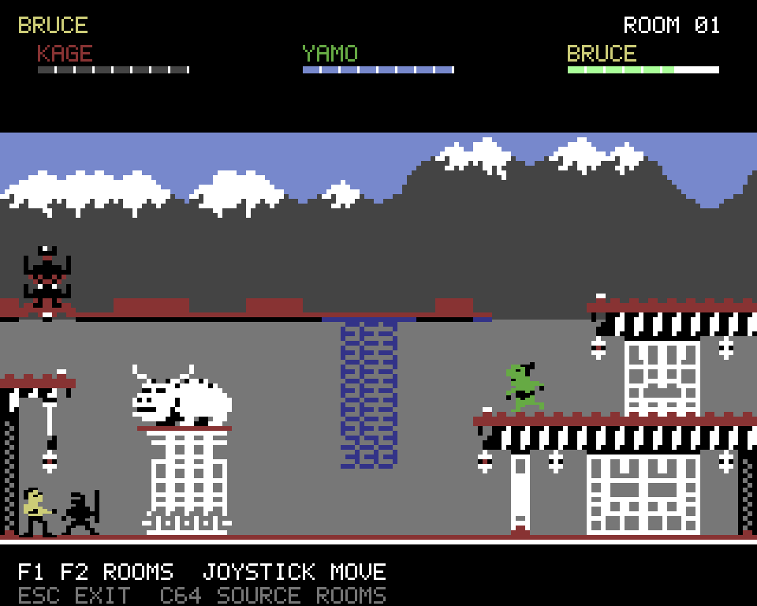

# C64-sprites som standard

Brukerbeslutning 25. oktober2026: egenlaget grafikk settes til side mens
C64-oppførselen rekonstrueres. Enhanced-grafikken beholdes som tidligere
arbeid, men er fjernet fra standardbyggets ressurskjede. Rommene bruker
allerede rippede C64-tegn. Figurene bruker nå også kandidatens egne piksler.

Frossen kilde: `.reference/c64/work/untrained-memory.bin`, SHA256
`092c50dbc997e301c75c7860a3c84026a93a7aaf543968ae36f1ffa19d0800b8`.
Dette er Remember/T64-kandidaten, ikke en bekreftet urørt1984-utgave.
Originalen og kildeutsjekkingene er uendret.

## Uttrekk fra faktisk kode

`python tools/build_c64_sprites.py` kjører originalens `$2584` og `$25E2`
i en6502-CPU med kontrollerte aktørdata. C64-instruksjonene foretar selv
kopieringen, inkludert operandendringene i `$2719`. Verktøyet leser deretter
de faktiske spritebufferne, VIC-posisjonene og fargeregistrene.

| Kilde | Betydning |
| --- | --- |
| `$59BD/$5A8F` | Pekere til210 komprimerte grafikkdeler |
| `$5B61`, `$5CBF` | Kopiteller og smal/bred rutine |
| `$5C33`, `$273A` | Farge per Bruce-/Yamo-del; Kage får `$F0`, synlig indeks0 |
| `$2584–$25E1`, `$26A0–$274E` | Primær-/sekundærlag, kopiering og nullfylling |
| `$274F–$277C`, `$2682–$269F` | To bufferbanker og VIC-spritepekere |
| `$25E2–$267F` | Lagvis X-offset, Y-posisjon og fargeregistre |
| `$07EF–$07FA` | Hires-sprites, dobbel X-bredde, normal Y, foran bakgrunnen |
| `$2780–$29C2` | Tilstands-/tellerstyrt valg av grunnpositur |
| `$59A5`, `$29AB–$29BF` | Artsforskyvning0/70/140 for Bruce/Yamo/Kage |

En bred grafikkdel kopieres med `2*teller` byte, en smal med `teller+1`.
Dette følger de to faktiske kopigrenene; et generisk21-raders bildeuttrekk
ville gitt feil for enkelte komponenter. Begge bufferbankene kontrolleres
for identiske synlige piksler.

Uttrekket ligger i `assets/c64/sprites-v1/`:210 PNG-er for35 grunnpositurer
per figur og begge verdier av retningen, kontaktark, rå komponentbytes,
OCS-planer, pakket DMA-bank, disassembly og manifest med adresser/hashverdier.
Retningene gjengis av originalrutinen; de speilvendes ikke av Amiga-koden.
De210 kombinasjonene gir80 ulike DMA-bilder etter tapsfri deduplisering.

VIC-sprite0/1 danner Bruce,2/3 Yamo og4 Kage. Lavere spritenummer er foran.
X-forskyvningen til hvert lag kommer fra koden, blant annet16 piksler for
enkelte brede venstrepositurer. Ankeret i48×21-lerretet er `(16,22)` relativt
til portens aktørkoordinat, med eksisterende VIC-skjermopprinnelse `(24,51)`.
Det brukes kildeindekser0,5 og7: svart Kage, grønn Yamo og gul Bruce.
Indeksene bruker rommotorens eksisterende12-bits OCS-palett. Opaque svart
har egen dekkmaske og blir aldri behandlet som gjennomsiktighet.

## Innkobling og avgrensning

`amiga-build.ps1` bygger `amiga/c64_sprite_data.h` fra dette uttrekket.
De tidligere AI-atlasene og grafikkgeneratorene kjøres ikke. Bare den
generiske, tapsfrie pakkekoden fra `build_fighter_dma.py` gjenbrukes;
ingen av de gamle bildene leses. Spritebufferen bruker73680 byte Chip RAM,
mot90912 før, og den pakkede banken bruker12852 byte mot44042 før.

Standardvisningen bruker direkte aktørkoordinater. Den tidligere visuelle
interpoleringen og de oppdiktede fire klatrefasene brukes ikke ved tegning.
Originalens grunnpositurer10/12 veksler ved klatreoppdateringer. Kage tegnes
bak Yamo, som tegnes bak Bruce; kildens prosjektiler6/7 tegnes bak disse.
Den tidligere generelle blinkingen ved skade er fjernet fra figurtegningen.

`core/c64_sprites.c:bl_source_pose` oversetter den komplette, avgrensede
positurvelgeren `$2780`, inkludert ventelås, tidligere positur, breddeflagg,
nettkontakt, spark-, stikk-, hopp-, fall- og reaksjonstellere.
`bl_c64_sprite_step` projiserer den eksisterende Amiga-aktøradapterens
tilstander inn i denne velgeren. Bruces klatre-/nettgange bruker nå samme
[kildebaserte pose som kontaktmotoren](C64_CLIMB.md), med kildeventing og CB.
Selve spritebroen skriver ikke tilbake til bevegelse,
objektkontakt, kamp eller AI. Denne broen er foreløpig: full `$1C5B`,
øvrige aktørtellere, inntreden, reaksjoner og global klokke må fortsatt porteres.
De tegnede bildene er kildepiksler, men hele sekvensens timing er derfor
ikke sertifisert som C64-paritet. Kontakt-/kampmaskene endres ikke av dette
spriteskiftet; full gang-/reaksjonskontakt og støtte-/landingsmotor gjenstår separat.
HUD, oppstartsforløp og motorens øvrige dokumenterte avvik er heller ikke
en full kopi av C64-spillet.

## Kontroller

Kjør `./test-c64-sprites.ps1`.17280 kontrollerte inngangstilstander sammenligner
den kompilerte C-velgeren med faktiske6502-instruksjoner.324 utvalgte
grense-/tilstandskontroller bygges også inn i Amiga-autotesten.211680
pikselkontroller sammenligner de lagrede PNG-ene og de ukomprimerte
OCS-planene med ny kjøring av kildens spritekopi. Pakkingen kontrolleres
med tapsfri tur-retur og en FNV-signatur på den dekodede native banken.

To A500-CLI-starter fullfører6000 felt hver med324 beståtte positurkontroller,
70 bevegelses-,29 objekt- og390 klatrekontroller. Begge har riktig dekodet sprite-FNV,
0 rester utenfor tegnegrensene,0 rom-/tegn-/aritmetikk-/lydfeil og samme
spill-/Paula-signatur som verten. OS gjenopprettes begge ganger.

Største sammenhengende Chip-blokk er88480 byte mot reservemålet49152,
og tilgjengelig utvidelsesminne før runtimeallokering er42048 byte.
Den strenge tidsporten er fortsatt åpen:242 forsinkede felt per kjøring,
med maksimal avstand2 og3 PAL-perioder. Romlasting måles separat, opptil100 felt.
Dette er testbyggets målinger, inkludert ekstra framebufferkopi; normalbyggets
minne og tidskadens er ikke målt her. Vanlig EXE er191376 byte, ADF901120.
`start` oppdateres til normalbygget; eksisterende interaktiv emulator restartes
ikke automatisk.

Gjeldende A500-målinger, kildeidentiteter og begrensninger ligger i
`reference/validation/c64-sprites-delivery.json`.
Testene injiserer aktørtilstander; de fastsetter ikke naturlig gjennomspilling,
full VIC/IRQ-emulering eller korrekthet for den gjenværende aktørmotoren.

