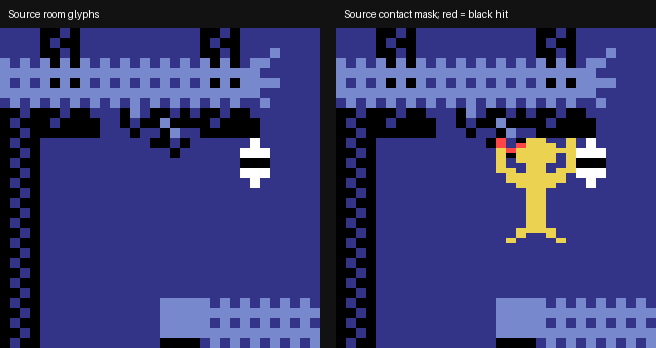

# Takfremspringet i rom 6

28. oktober 2026. Kilde er de faktiske bytene i den frosne Remember/T64-
kandidaten, SHA256 `092c50dbc997e301c75c7860a3c84026a93a7aaf543968ae36f1ffa19d0800b8`.
Kandidaten er fortsatt ikke sertifisert som urørt 1984-utgave.

## Kildeavklart oppførsel

Den lille spissen under taket er kolliderende i kildekoden. Etter at øvre
venstre lanterne er plukket, ligger taktegnene `$50/$D0` fortsatt i cellene
204/244, ved tegnmatriseadressene `$8CCC/$8CF4`. Tegnsettet er `$A000`.
For eksempel har `$D0` sin første rad ved `$A680` verdien `$30`. Det gir
et multicolor-par med verdi 3 ved skjermkoordinat x34–35/y48. Attributtets
lave tre bits er null, og kontakten blir svart klasse, bit `$08`.

Kontrollsekvensen bruker den faktiske `$2E39`-objektrutinen til først å
plukke venstre lanterne. `$13/$93` ved `$8CCA/$8CF2` erstattes da med
`$1E/$9E`. Dermed forveksles ikke lanternens egne svarte piksler med den
lille takspissen som blir igjen i brukerens bilde.

`$5212` beregner kontakten med den gjeldende figurmasken. I et kontrollert
stående hopp med spritevenstre x32 og fot-Y67 brukes maskeposituren32,
peker `$9600`. Taket treffer masken ved x32/y46–47, x36/y47 og spissens
x34/y48, der maskebyten er `$9602`. Både `$B6` og kroppsklassen `$A7` blir
`$08`. `$1CC7–$1CCB` tester dette bitet; `$1CD0–$1D6E` reverserer lagret
bevegelse og velger veggrestitusjon, tilstand24. Her flyttes fot-Y67 til69.
Dette er den felles veggrutinen; ingen egen Amiga-regel for hodestøt kreves.

Som isolerende kontroll nulles de fire berørte tegnradene i en separat
arbeidskopi. Samme faktiske `$5212` gir da kontakt0. Verken spillets
geometri, originalfiler eller produksjonsressurser er endret.

## Kontroller

`test-r06-ceiling.ps1` bygger en vertskompilert bro av gjeldende Amiga-logikk.
`tools/audit_r06_ceiling.py` kjører de faktiske 6502-bytene og sammenligner
alle65536 RAM-bytes og ti registre etter hvert rutinekall:

- Sju injiserte ruter, 48 aktørsteg hver: tre diagonale mot venstre og fire
  stående hopp rundt spissen. Stående x32/x36 treffer taket; x40/x44 har
  fri passasje i de undersøkte forløpene. De diagonale rutene dekker også
  venstre vegg og illustrerer at svart kontakt må stedfestes.
- Kildens rekkefølge `$1C0D/$1C10/$17BE` beholdes: kontakt, objekter,
  aktøroppdatering og posevalg. Objektinnsamling er med under rutene.
- **1354 full-RAM-/registersammenligninger**, **1048800 faktiske
  6502-instruksjoner**, uten avvik.

[Maskinlesbart resultat og adressert disassembly](../reference/analysis/ceiling-r06-2026-10-28/).
Venstre bilde viser kildegrafikken etter innsamling. Høyre viser
kontaktmasken; rødt er berørte svarte piksler.

Dette er kildebasert avklaring med kontrollerte innganger. IRQ/rasterfase,
romløkken og kamp er utelatt i denne avgrensede kontrollen. Brukerens
skjermbilde har ingen inputhistorikk eller eget snapshot for dette treffet;
det er ikke grunnlag for å hevde naturlig gjennomspillingsparitet eller at
alle tenkelige taktreff er avklart. Ingen ny 68000-kjøring eller ny spill-
build påstås: produksjonskoden er uendret fra `c34174c`, der de native
kontaktkjernene og hele-RAM-fixturene allerede er kontrollert separat.
