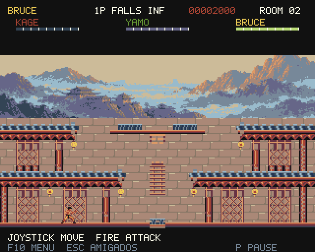

# Bruce – første spillbare Enhanced-utgave

Ved oppstart er **F4 LOOK** satt til **CLASSIC**. Velg **ENHANCED** med F4 i hovedmenyen. Fire starter spillet. Return virker også når brettvalg er av. F10 åpner menyen under vanlig spill. Med brettvalg på åpner F8 menyen, og F9/F10 blar mellom brett. Begge utseendene ligger på samme spilldiskett.

| | Classic | Enhanced |
| --- | --- | --- |
| Figurer | Rippede C64-bilder | Editorens bibliotek har 13 Enhanced-positurer for hver fiende og 14 plasser for Bruce. I spillet har Yamo og Kage grafikk for samtlige 35 kildepositurer i begge retninger. |
| Bevegelse | Kildens positur | Bruce veksler hånd og kne i klatringen. Yamos grønne kropp og Kages kendo-stav følger den synlige masken og plasseringen til hver kildefigur, også når positur og retning skifter på ulike steg. |
| Bakgrunn | C64-romtegn og Classic-palett | Fjellandskap og varm tegl i rom 1–3. Skifermur i rom 4–18. Gårdsrommene har glaserte takstein, bjelkehoder, gjennombrutte treskjermer og bambusstiger. Utvalgte avsatser og søyler i gallerier og hvelv har egne steinfliser. Bevegelige felleblokker og bakgrunnstegnene i rom 19–20 bruker kildetegneren. |

Dragen på sokkelen og ornamentet på øvre avsats har metalltoner i rom 1. [Rom 1 i WinUAE](../reference/analysis/enhanced-2026-11-01/room-01-architecture.png)

## Farten på fellene i rom 14

I Remember/T64-kandidaten lar `$3EBC–$3EC0` fellene flytte seg når
`$7B` er null. `$104B–$10B4` oppdaterer posisjonene, og
`$404E/$4063` bestiller tegn til gammel og ny posisjon. Fellene bruker
`$64↔$65` eller `$66↔$67` med nedre tegnhalvdel 128 koder høyere.
I tegnbanken ved `$A800` skiller de vanlige øvre tegnhalvdelene seg på
to pikselrader. De nedre tegnhalvdelene er parvis identiske.
Kilde-SHA256 er `092c50dbc997e301c75c7860a3c84026a93a7aaf543968ae36f1ffa19d0800b8`.

Amiga sammenligner de levende tegnradene når en slik felle flytter seg.
Bare ulike radpar må tegnes og kopieres til skjermbufferne. Endring av
tegnkode oppdaterer fortsatt kollisjonsdataene for hele cellen. Hvis
Enhanced får egne bilder for disse tegnene, slår grafikkpakkeren av
denne snarveien for Enhanced.

På PAL A500 i WinUAE med 512 + 512 KiB og hopp holdt inne gikk Enhanced
fra 4,24 til 3,09 PAL-felt per spillsteg. En separat kontroll av sporet
på tegnrad 13 målte 57 synlige ruteforflytninger på 486 felt før, og
77 på 487 felt etter. Rommet ble valgt i testmenyen med udødelighet.
[Målinger fra de vanlige spilldiskettene](../reference/analysis/room14-speed-2026-11-04/report.json)

## Tårntaket i rom 16

Romstrømmen ved `$7BB4–$7C5B` i Remember/T64-kandidaten setter sammen
taket av `$0C,$0A,$19,$0D,$23,$0B` på tegnrad 3–4. Takutstikkene
på etasjene under bruker `$2F`, med skråstøtter av `$19/$23`.
Enhanced tegner glasert terrakotta, kobberkanter og en mørk underside
innenfor silhuetten fra tegnbanken ved `$A800`. Disse flisene brukes i
kolonne 13–27 til og med tegnrad 14. Sideplattformene og gulvet bruker
fortsatt den vanlige romgrafikken.

Ved `$3EE6–$3F2F` leser romrutinen lanternepostene og åpner venstre
og høyre passasje. Den skriver tomt felt og `$2F` på hver side gjennom
tegnstrengene ved `$4732/$4734`. Taket følger de levende tegnene også
etter åpning. Kilde-SHA256 er
`092c50dbc997e301c75c7860a3c84026a93a7aaf543968ae36f1ffa19d0800b8`.

I WinUAE på PAL A500 med 512 + 512 KiB ble taket kontrollert ved første
besøk og etter retur fra rom 17 med brettvelgeren. Ved returen samsvarte
tegnradene og skrivene til `$CE11/$CE17` med kandidatens gren ved
`$1A7B–$1A89` for nedre tegnhalvdel. På samme diskett ble figurdataene
i Classic pakket fra 12 852 til 10 390 byte og kontrollert mot alle
73 680 utpakkede byte i Chip RAM.
[Tårntaket før og etter i WinUAE](../reference/analysis/room16-roof-2026-11-04/room-16.png)

## Lanternene i rom 11

Lanternepostene ved `$4E1E` i Remember/T64-kandidaten angir tre
posisjoner som kolonne og romrad: (1, 4), (30, 7) og (30, 10).
Alle tre viser tegnparet `$14/$94` fra banken ved `$A800`.
Ved `$4117–$411F` skriver kildekoden en av fire flammeverdier til
`$ACA2/$ACA3`. De speilvendte lyktene i samme tegnbank bruker
`$13/$93` og `$AC9A/$AC9B`.

Enhanced gir begge variantene en ravgul skjerm med mørk kant. Den
lysende kroppen er synlig i alle fire faser. Etter et plukk skriver
`$2F04–$2F1F` erstatningstegnene fra lanterneposten. I rom 11 er det
`$1F/$9F`, som bare viser festet mot muren. Kilde-SHA256 er
`092c50dbc997e301c75c7860a3c84026a93a7aaf543968ae36f1ffa19d0800b8`.

På PAL A500 i WinUAE med 512 + 512 KiB stemte alle 128 piksler i hver av
de tre lanternene i alle fire flammefaser. I plukktesten ble Bruce
plassert ved hver lykt med debuggeren. Den vanlige spilløkka tok lykten,
reduserte romtelleren og tegnet det tomme festet ved alle tre posisjoner.
[Rom 11 før innsamling](../reference/analysis/room11-lanterns-2026-11-04/room-11.png)

## Tårnene i rom 4

Romstrømmen ved `$6C9D–$6E1A` i Remember/T64-kandidaten bruker
`$68/$3C/$6A/$69` i tårnkronene og `$36/$09/$0A` i murverket.
Tårnene begynner på tegnrad 7. Noen av de samme tegnene inngår i
fjellsilhuetten på rad 3 og 5. Enhanced velger derfor egne steinfliser
først fra rad 7 i dette rommet. Hver flis følger dekningen i
C64-tegnbanken ved `$A000`, også rundt åpningene.

Romrutinen ved `$3726–$375D` veksler mellom to strenger ved
`$449E` og `$4766`. De bytter sju `$4B` med sju `$09` under de to
midttårnene. Begge stillinger har sandsteinsgrafikk. Kilde-SHA256 er
`092c50dbc997e301c75c7860a3c84026a93a7aaf543968ae36f1ffa19d0800b8`.

På PAL A500 i WinUAE med 512 + 512 KiB ble 13 952 piksler i hver
stilling kontrollert i bakgrunnsbufferen. Utvalget omfattet tårnene,
de delte fjelltegnene og piggene. [Tårnene før rettingen av fjellbakgrunnen](../reference/analysis/room04-towers-2026-11-04/room-04.png)

### Fjellene bak tårnene

I romstrømmen inneholder tegnrad 3–6 bare landskap. På rad 7–10 står
tårnkroner, vinduer og gesimser foran horisonten. I Enhanced vises
fjellpanoramaet gjennom åpningene, også der tårnene bruker de samme
tegnkodene som fjellene øverst. Den blå skifermuren begynner på rad 11
ved øvre avsats. Bildet bruker det eksisterende panoramaet på 320 × 64
piksler i Chip RAM. I WinUAE med PAL OCS og 512 + 512 KiB ble både
fjellutsikten gjennom åpningene og de to vekslende tårnpartiene
kontrollert fra den ferdige spilldisketten.
[Rom 4 med fjellpanoramaet](../reference/analysis/room04-sky-2026-11-04/room-04.png)

## Statuen som rauter i rom 3

Romrutinen i den frosne Remember/T64-kandidaten sjekker `$30`
(gjenstående lanterner i rom 7) ved `$36AE`. Når telleren er null, styrer
`$7B` og nedtellingen ved `$4E99` munnbevegelsen. Ved `$36DD–$36F9`
bestiller første fase lyd `$81`. Rutinen veksler mellom tegnstrengene
`$1D` og `$1E` ved `$45E4/$45E6`. Tegneren ved `$17E2` skriver
`$46/$C6` eller `$47/$C7` i kolonne 33, tegnrad 17 og 18.
Kilde-SHA256 er `092c50dbc997e301c75c7860a3c84026a93a7aaf543968ae36f1ffa19d0800b8`.

Enhanced skyggelegger begge kjevestillingene sammen med hodet og sokkelen.
En WinUAE-prøve på PAL A500 med 512 + 512 KiB gikk fra rom 3 til rom 8
og tilbake med brettvelgeren. Første besøk viste hvilestillingen. Etter
returen stemte alle 128 pikslene i munnfeltet fire ganger på rad mens
spillet vekslet mellom stillingene.
[Begge munnstillinger fra skjermbufferen](../reference/analysis/room03-mouth-2026-11-04/room03-mouth.png)

## De smale veggene i rom 6

Romstrømmen ved `$6F82–$70DC` i den frosne Remember/T64-kandidaten legger
veggfoten `$2E/$AE` i kolonne 0, 25, 31 og 39 ved nederste gulv. De øvre
seks radene ved `$A170` er identiske med veggtegnet `$32` ved `$A190`.
På de to neste radene deler veggen (bitpar 3) plassen med gulvkanten
(bitpar 1). Kilde-SHA256 er
`092c50dbc997e301c75c7860a3c84026a93a7aaf543968ae36f1ffa19d0800b8`.

Enhanced brukte mursteinens blå bunnfarge på veggfoten. Nå fortsetter veggens
kontur og høylys ned til gulvet. På den viste WinUAE-skjermen samsvarte alle
144 veggpiksler i de seks radene ved de fire skjøtene med veggtegnet over.
[Utsnitt før og etter](../reference/analysis/room06-wall-2026-11-04/gallery-posts.png)

## Motor og minne

Begge moduser bruker samme kontrolleravlesing, C64-aktørmotor, kontaktmasker, treffvinduer, romdata og lyd. Enhanced velger konstruksjon etter romgruppe og levende tegnkode. Hver ny 8×8-flis har de åtte kilderadene den kan erstatte, en visuell maske og fire fargeplan. Et endret tegn kan dermed vise en åpen luke eller fjerne en lanterne. Lykteflammen følger de fire verdiene fra kandidatens rutine ved `$40CE–$4127`. I rom 2 byttes tegnene `$13/$14/$31` til `$1E/$1F/$12` ved innsamling. Bjelken over lykten beholder samme farger i begge tilstander. [Tegnbanker og kildehash](../assets/c64/rooms-v1/manifest.json)

Spillet pakker de aktive figurene ut i den eksisterende Chip-bufferen. I bygget med tre Bruce-redigeringer bruker Enhanced 51 248 byte til figurene og 10 240 til himmelen, totalt 61 488 av 73 680 byte før klippebufferen. Lik grafikk kan deles på forskjellige ankerpunkter. Smale figurer bruker fire byte per maske- eller fargerad, øvrige bruker seks. CPU-en leser murflisene fra en egen tabell når rommet tegnes.

### Figurer mot muren i rom 2

Bruce bruker fire OCS-farger i de nye grunnbildene: ravfarget hud `$D96`, terrakotta til skyggene `$A43`, gule bukser `$EC5` og mørkt hår, belte og sko `$111`. KI-malen har tolv positurer tegnet innenfor C64-omrissene. Klatringen veksler arm og kne, og venstreslaget bruker den opprinnelige asymmetriske albuen. [Sammenlign gammel og ny Bruce](../reference/analysis/enhanced-2026-11-01/bruce-coarse-comparison.png) · [Prompt og kildeark](../assets/graphics/enhanced-study/coarse-bruce-generation.json).

Yamo har grønt hudlys, kjølig skygge under haka og armen og et lyst belte over den mørke brytebuksa. Fargestrøkene følger hver positur ved spillets oppløsning. Den tidligere sammenligningen viser første kontrastjustering, før Bruce fikk fjernet de hvite høylysene. [Tidligere før og etter i rom 2](../reference/analysis/enhanced-2026-11-01/fighter-inks.png) · [Fargestrøk for figurene](../tools/enhanced_fighters.py)

Diskettprøven sammenlignet 61 056 byte figurdata i Chip RAM med de ferdigpakkede positurene. Alle 80 retningsbildene beholdt maskene sine. I en separat bildeprøve ble figurene plassert på stigen og gulvet i rom 2 mens begge fiendene var aktive. [Skjermbilde fra WinUAE](../reference/analysis/enhanced-2026-11-01/fighter-inks-winuae.png) · [Målinger og bygghasher](../reference/analysis/enhanced-2026-11-01/fighter-inks.json)

## Ensartet størrelse på Bruce

Brukerens sparkebilde i rom 6 avdekket at Enhanced blandet størrelser: gard var 17 piksler høy og løpebildene 14–16, mens slag og spark allerede brukte C64-kandidatens silhuetter. Det fantes ingen romavhengig skalering. Gard er nå 21 piksler høy og løp 19, som de tilsvarende kildebildene. Klatring, luftpositur, treffreaksjon og nedslag har også kildebaserte silhuetter og ankre, med ny fargelegging innenfor maskene.

Kandidatens `$2584/$25E2` bygger og plasserer spritekomponentene. `$2996–$299F` velger gard `$00/$02`; `$28CB–$2900` veksler løp `$0E/$10` mot venstre og `$12/$14` mot høyre; `$2985–$2993` veksler klatring `$0A/$0C`. Atlasets retningspar er dokumentert i `BRUCE_SOURCE_POSES`. Valg av Bruce-løpebilde følger nå kildeposituren, ikke X-posisjonen. De seks angrepsbildenes masker og rekkevidde er uendret. Ingen kontakt- eller spillregler er endret.

Yamo og Kage henter sin geometri fra kandidatens spriteuttrekk. Hver av de 140 kombinasjonene av figur, positur og retning har sitt opprinnelige omriss på 48 × 21-flaten. De alternative Enhanced-løpebildene følger samme regel. Kildens anker er X minus 16 og Y minus 22. Uttrekket bygger på Remember/T64-kandidaten, som ikke er bekreftet som en urørt 1984-utgave.

Enhanced-grafikken for Yamo og Kage er tegnet med store, sammenhengende fargefelt fra første KI-utkast. De åtte grunnpositurene per figur er lagret i spilloppløsning. Yamo bruker fire farger og Kage fem. Ved konvertering velges en palettfarge per piksel før posituren legges i C64-omrisset. [Før og etter ved 1× og 3×](../reference/analysis/enhanced-2026-11-01/enemy-coarse-comparison.png) · [Kildebilder, prompter og filhasher](../assets/graphics/enhanced-study/coarse-enemy-generation.json).

[Før/etter, samme målestokk og fotlinje](../reference/analysis/enhanced-2026-11-01/bruce-proportions.png) · [Silhuetter, kildehash og Amiga-prøve](../reference/analysis/enhanced-2026-11-01/bruce-proportions.json)

Diskettprøven i WinUAE på PAL A500/512+512 KiB sammenlignet alle 60 048 byte i den aktive figurcachen med pakkeren. Vanlig joystick utløste gjenkjente slag og spark i rom 1 og rom 6. Begge fiender var aktive i en prøve, og Classic → Enhanced → Classic bestod. Romreisen brukte debug-romvalg og udødelighet. [Bruce i rom 6](../reference/analysis/enhanced-2026-11-01/bruce-proportions-room06.png)

## Bruces knyttneve og flyvespark

I det første Enhanced-bygget endte knyttneven fem skjermpiksler for tidlig og fire rader for lavt. I det utstrakte sparket manglet åtte piksler i lengderetningen. Begge målingene er gjort på figurens 48×21-flate med samme anker som i spillet. Enhanced fargelegger nå de opake pikslene fra kandidatens spriteutskrift ved `$2584/$25E2`. Slagtilstand 17 velger `$04/$06` etter retning ved `$282F–$283E`. Sparktilstandene 12 og 13 velger `$16/$1A` ved teller minst 10, ellers `$18/$1C`, ved `$288B–$28B0`. De andre hoppebildene har fortsatt egne silhuetter. Motstandernes Enhanced-grafikk kan gi en annen synlig kontur på deres side av treffet. [Kildedisassembly](../assets/c64/sprites-v1/source-disassembly.txt) · [Farger og kildehash](../assets/graphics/enhanced-study/generation.json)

Diskettprøven på PAL A500 i WinUAE sammenlignet alle 6 048 piksler i de seks retningsbestemte angrepsbildene med utskrift fra den frosne C64-kandidatens spriteprogram. Med joystick ble høyreslaget og det utstrakte høyresparket gjenkjent i den publiserte skjermbufferen. [Sammenligning før og etter](../reference/analysis/enhanced-2026-11-01/bruce-strikes.png) · [WinUAE-måling](../reference/analysis/enhanced-2026-11-01/bruce-strikes.json)

## Enhanced combat audio

Bruce, Yamo and Kage each have two punch and two kick sounds. Kage's weapon thrust has its own two blade sounds. Since 12 November 2026, a hit on Yamo plays one of two new dry impact samples instead of the former vocal grunts. The same non-vocal pair covers Yamo's lethal trap hits. His attack sounds are unchanged. Classic continues to use its source audio.

The new pair was generated locally with AudioGen medium from a padded-bag impact prompt explicitly excluding voices, grunts and shouting. Each selected clip is 110 ms at 8 kHz; the existing alternating playback periods give 112.14 and 107.93 ms. Each stores 440 packed bytes and expands into 880 bytes of an existing 1,024-byte Paula page. There is no extra Chip-RAM allocation. The 12 November bank contained 16 samples in 6,870 bytes, excluding tables; the finishing cry below adds 500 bytes. [New Yamo preview](../assets/audio/enhanced-yamo-hit-v2/preview.wav) · [Prompts, raw sources and conversion metadata](../assets/audio/enhanced-yamo-hit-v2/sources.json) · [Original v1 sources, retained unchanged](../assets/audio/enhanced-v1/sources.json).

The source queue still selects the accepted effect and voice. In frozen C64 candidate `092c50dbc997e301c75c7860a3c84026a93a7aaf543968ae36f1ffa19d0800b8`, `$2509-$255D` chooses the queue by availability and priority. `$205A/$209F` are kicks, `$227C` is a punch and `$22D2` is Kage's thrust. X identifies the victim at `$2E30/$2A93`; traps use saved actor `$51` at `$3059`. These three Yamo-victim sites now select `FX_YAMO_HIT`. This changes the Enhanced sample only, with no new attack, collision or timing rule. Short swings that miss the source's sound threshold may still use a free Enhanced voice; source effects retain priority. [Player](../amiga/enhanced_audio.h) · [Queue and sample tests](../tests/enhanced_audio_test.c).

The host check covers all 16 packed samples, concurrent voices, alternating variants, queue priority, short swings, silence reload and return to source waves. A controlled normal-ADF WinUAE check verifies the two new Yamo samples and periods in the real Paula voice page; it is not a natural combat playthrough. [Current validation](../reference/analysis/yamo-impact-2026-11-12/report.json). The earlier v1 bank also had a recorded 16-sample Paula check and joystick-triggered Bruce attacks; that recording contains the old Yamo grunts. [Historical recording](../reference/analysis/enhanced-2026-11-01/combat-paula.wav) · [Historical measurements](../reference/analysis/enhanced-2026-11-01/combat-paula.json).

### Bruce's finishing cry — 14 November 2026

Enhanced plays a short “Pfhaaaia!” when Bruce's punch takes an enemy's final energy. Ordinary hits, kicks, trap deaths and kills by other actors do not request it. The 250 ms sample uses 500 packed bytes and 1,000 decoded bytes in an existing Paula voice page. The bank now holds 17 unique samples in 7,370 packed bytes, with 18 playback entries; both finisher variant entries share the same clip. The cry finishes before that voice resumes source sound. Classic does not register the finisher observer.

The observer follows the frozen candidate's accepted punch at `$2AC3` (Y=attacker, X=victim) and its lethal subtraction branch at `$2BCB`, after `$2BC4–$2BC9` subtracts three health points. Source health 0–2 enters the death branch; 3 becomes zero and survives this particular hit. The observer changes no source RAM or processor flags. This is an Enhanced sound addition, not a claim that the C64 has this cry.

[Preview](../assets/audio/enhanced-bruce-finish-v1/preview.wav) · [Prompt and provenance](../assets/audio/enhanced-bruce-finish-v1/sources.json) · [Validation](../reference/analysis/bruce-finisher-2026-11-14/report.json). Host checks cover 16 controlled combat cases and unchanged RAM/register results. The normal-ADF WinUAE check starts from controlled actor positions and health, then uses ordinary Fire to trigger a lethal punch against each enemy. It also checks the decoded Paula page and Classic observer removal. Natural combat listening and physical-Amiga acceptance remain open.

## Kontroll av ny arkitektur, 1. november 2026

Diskettbygget startet i WinUAE på PAL A500 med 512+512 KiB. Begge menyvalg startet, og alle 20 rom ble besøkt via debugmenyen. Testen leste de aktive Copper-fargene og sammenlignet rombakgrunnen med flistegningene og de levende kildetegnene. I rom 2 stemte alle 35 712 kontrollerte piksler. Prøvene i rom 1, 6 og 12 stemte også. Begge Classic-opptakene av rom 1 hadde samme bakgrunnshash som tilsvarende opptak før omtegningen. En separat, kontrollert vertsprøve prøvde fire flammefaser og alle seks lanterneplukk i rom 2. [Målinger og bygghasher](../reference/analysis/enhanced-2026-11-01/architecture.json)

## Første Enhanced-bygg, 1. november 2026

- **PAL A500 i WinUAE**, OCS, Kickstart 1.3, 512 KiB Chip og 512 KiB utvidelse. Både CLI- og diskettoppstart viste riktig meny, startet hver modus og kom tilbake til Classic. Utvalgte himmelrader i den gjenopprettede Classic-bakgrunnen var byteidentiske med første Classic-oppstart. [Diskettmåling](../reference/analysis/enhanced-2026-11-01/adf.json)
- **Rom og grafikk.** I Enhanced ble 8 012 forgrunnspiksler i rom 1 og 10 892 i rom 2 kontrollert mot tegn og farger i levende C64-RAM. Alle 20 rom ble besøkt via debug-romvalg. Dette dekker innlasting og tegning. Naturlig gjennomspilling av overgangene er en egen test. [CLI-prøve og rombesøk](../reference/analysis/enhanced-2026-11-01/cli-tour.json)
- **Spilltilstand.** En kontrollert vertsprøve kjørte begge bakgrunnstegnerne med identiske joystickdata, 2 400 felt og rom 1, 2, 6, 12, 19 og 20. Hele kilde-RAM på 65 536 byte var identisk etter hvert av 800 spillsteg. Prøven tester om visningsbanen påvirker motoren. Den måler ikke hastigheten på en 68000. [Gjenta prøven](../reference/analysis/enhanced-2026-11-01/replay.ps1)
- **Kamp på Amiga.** Diskettprøven registrerte 43 steg over 127 PAL-felt i et kort vindu, med begge fiendene aktive ved begge avlesinger. Telleren for tapte lydtikk økte ikke. Den lengre kampmålingen fra før Enhanced er fortsatt referansen for videre ytelsesarbeid. [Tidligere måling](OP_A500_ACCEPTANCE.md)

## RC2 combat sound selection, 14 November 2026

The user-approved listening takes are now in Enhanced: the supplied `Bruce shout.mp3`, Kage's quick and broad weapon swishes, and Kage Kick Variant 2. Their selected WAVs and exact prompts/conversion records are in `assets/audio/enhanced-combat-v2/`. The original audition takes and older production banks are preserved.

The former lethal-punch-only cry described above is superseded. Each Bruce punch playback has a one-in-three chance to use the imported shout while no shout is already playing; other punches use the ordinary punch variants. A presentation-only 16-bit generator selects the sound without reading or modifying the C64 RNG or game state. The browser Play button always plays its chosen clip.

The two swishes and full one-second shout are quantized identically to the approved Amiga preview and placed in a dedicated 13,600-byte Chip-memory hunk. Paula plays them directly. The other samples retain the packed bank and existing 1024-byte source-voice pages. Long clips cannot be cut short by footsteps and Bruce's voice cannot overlap itself. No source gameplay routine or Classic sound mapping changes.

Use `test-enhanced-audio.ps1` for the routing, full-period probability and source-state checks; `tools/check_rc2_audio.py` checks the owned WinUAE normal disk. The current native checks resolve the BSS hunk from ELF rather than assuming four hunks. Historical diagnostics tied to older four-hunk probe builds should be used with those matching builds.

## Knockout-only cry correction, 19 November 2026

The current working build corrects RC2's interpretation: a one-in-three random draw happens only when Bruce knocks out Kage or Yamo with a fist. Ordinary swings, surviving hits, kicks and deaths caused by traps or other fighters cannot trigger or advance the cry selection. Existing cries cannot overlap and pending requests are discarded on room changes. The browser test still plays each selected sound unconditionally.

This reuses the existing source observer. Frozen candidate SHA256 `092c50dbc997e301c75c7860a3c84026a93a7aaf543968ae36f1ffa19d0800b8`: an accepted Bruce punch passes `$2AC3` with Y=0 and X=1/2. The `$2BC4-$2BC9` sequence is `B5 D1 38 E9 03 95 D1`, subtracting three health points. `$2BCB: 30 57` takes the negative branch to `$2C24`; health 0-2 crosses into death, whereas 3 becomes zero and survives that hit. The existing observer additionally excludes already-negative health. These source branches are unchanged; the chance draw is an Enhanced presentation rule requested by the user, not a C64 game rule.

The host tests exercise both chance outcomes across 32 source combat cases, compare all 65,536 bytes and source registers, and count 21,845 selections over 65,535 knockout draws. The native check is `tools/check_finisher_audio.py`: controlled positions, health and sound-choice seeds followed by ordinary Fire input, plus empty swings and Classic observer removal. RC2 artifacts and their historical evidence are left unchanged.

## Vault spear visibility, 21 November 2026

The vault spear `$40/$C0` now uses light ink for its blade pixels. Room 12's original colour 11 matched the Enhanced masonry and concealed the hazard. Mounting caps, source geometry and Classic remain unchanged. The normal ADF passes 1,044 ceiling-blade pixel checks per mode and 21,888 Enhanced structure pixel checks. [Evidence and the separate C64-derived Yamo recovery finding](ROOM12_SPEARS_YAMO_RECOVERY.md).

## Vault caps and emblems, 21 November 2026

The white top fittings in rooms 15 and 17 now use blue steel and bronze trim. Vault emblems retain the original yin-yang motif, with black/white and black/yellow variants; extra-life yellow follows live C64 colour RAM. The initial coin design was replaced following user feedback. Classic, source collision and pickup rules remain unchanged. The new assets are also available in the graphics editor. [Source conditions and validation](VAULT_EMBLEMS.md).
