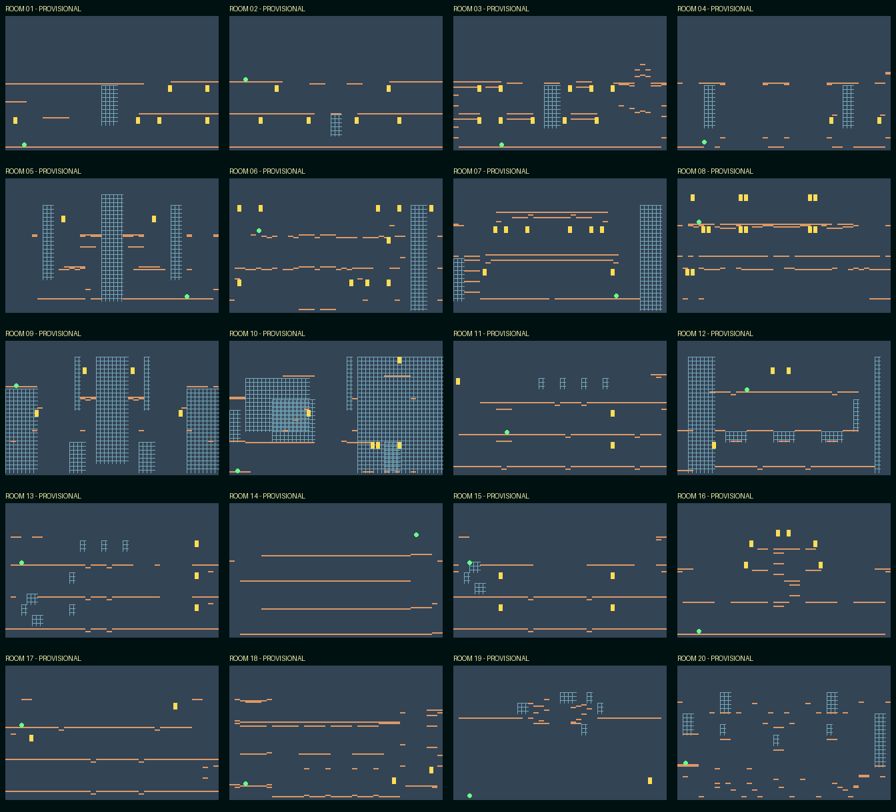

# Andre M4-del: 20-roms testutgave

Historisk blokkromkandidat. Den nye kildebaserte rommotoren og gjeldende
begrensninger beskrives i [romrekonstruksjonen](ROOM_RECONSTRUCTION.md).


Dette er et større romgrunnlag, ikke ferdig M4 eller en godkjent port av hele
C64-spillet. Alle 20 rom kan velges og undersøkes med Bruce. De nye rommene
har foreløpig geometri fra et dokumentert, forenklet tile-uttrekk, ikke en
full oversettelse av C64s pikselkollisjon eller romspesifikke kode.

## Kontroller

- Joystick: bevegelse, hopp, klatring, ned/ligge og ild som før.
- F1: forrige rom. F2: neste rom. Dette er eksplisitt inspeksjon og gir ikke
  poeng eller en påstått naturlig gjennomspilling. Bruce får nytt utgangspunkt.
- Escape: tilbake til AmigaDOS. Museklikk avslutter ikke.
- `start` i CLI: start samme vanlige spillbygg igjen ved filsystemoppstart.

## Hva romløftet inneholder

- Egne plattform- og nettlister for alle rom; ingen skjult reserve til rom 1.
- De statiske dørtabellene er tilgjengelige for alle 20 rom. Den tidligere
  sperrede forbindelsen fra rom 2 til rom 3 kan brukes.
- De første dynamiske åpningene er lagt til: gulvluke i rom 2, retur fra
  rom 6 og høyre utgang i rom 3. Se [betingelser og kilder](ANIMATION_AND_OPENINGS_2026-10-24.md).
- Innvendige statiske dørpunkter kan undersøkes med ned ved dørens område.
  Dette inputvilkåret er foreløpig og ikke sertifisert som originalens regel.
- Rom som C64-dataene markerer uten fiender holder dem deaktivert.
- Fiendenes romvise posisjoner brukes ved gjeninntreden.
- Når Bruce får nytt liv, nullstilles fiendene i rommet med helse og
  ventetellere. Lanterner ved død endres ikke før resetregelen er avklart.
- Egen skissegrafikk er kompilert til tapsfritt komprimerte bitplanbilder.
  Felles bakgrunn lagres én gang, og hvert rom som en XOR-differanse.
- To utpakkede bakgrunnsbilder brukes som cache i Chip RAM. Alle rom får
  derfor plass uten 20 fulle bakgrunnsallokeringer.



Grønt punkt er utgangspunktet. Bildet er egen geometriforhåndsvisning,
ikke C64-grafikk eller ferdig AI-forbedret Amiga-kunst.

## Hva som fortsatt mangler

Rominitiering og romløkker kan lage dører, broer og farer som ikke finnes som
vanlige åpne dører i den statiske strømmen. Hele kartet er derfor ennå ikke
naturlig sammenbundet. Feller, bevegelige broer, betingede åpninger,
sluttforløp, liv/Game Over og spillermoduser må implementeres og måles videre.
F1/F2 omgår dette for inspeksjon; det godkjenner ikke progresjonen.

Nye rom er strukturelle kandidater. Vegger, dekorsamspill, trapper og presise
støtte-/gripeområder kan være feil. Kjente avvik i falltreff, slag mot Yamos
spark og kantstøtte er fortsatt i [den aktive testlisten](ACTIVE_TESTS.md).
De gamle godkjente testene er arkivert og skal ikke testes på nytt bare fordi
de fantes i den opprinnelige listen.

## Bygging og kontroll

`amiga-build.ps1` kompilerer bakgrunnene fra semantisk geometri før C-bygget.
Pakkingen bruker bare dette prosjektets egen skissekunst, ikke originalpiksler.
Uttrekking av nye semantiske blokkutgaver krever den lokale C64-kandidaten:

```text
python tools/build_room_geometry.py
python tools/build_room_backgrounds.py
.\test-core.ps1
.\test-parity.ps1
.\test-amiga.ps1 -RoomTour -Disk
```

Romrundturen bruker samme inspeksjonsinngang som F1/F2 og besøker alle 20 rom.
Den måler minne, romlasting, visning og vanlige feltgap. Dette er en test av
Amiga-kjøringen, ikke et bevis for at alle rom kan nås med original progresjon.
Ferdige kildehash-låste rapporter ligger i `reference/validation/`.

Rundturen på A500-profilen 24. oktober besøkte alle 20 rom i 7200 tegnede
PAL-felt fra ADF-oppstart. Den hadde 19 romlastinger, null tapte vanlige
spillbilder, 166 944 byte eksplisitt Chip-allokering og 272 360 byte i største
ledige Chip-blokk etter lasting. Største vanlige arbeidsintervall var 244
rasterlinjer. Største romlastingsintervall var 25 felt, omtrent 0,5 sekunder.
De særskilte romlastingene godkjenner ikke lik lastetid som C64.

En tidligere utgave tegnet bakgrunnene på nytt på 68000 ved cache-miss og
brukte opptil 139 felt ved lasting. Den første repetisjonen besøkte alle rom,
men samlet to repetisjoner traff tidsgrensen. Denne utgaven er erstattet av
de komprimerte bakgrunnene; den mislykkede repetisjonstesten er ikke brukt
som godkjenningsgrunnlag.

## Grafikkarbeidet

[Grafikkflyten](AMIGA_ART_PIPELINE.md) har lokal uttrekking, ressursinventar,
gjenbrukbar prompt, ankre og OCS-validering. Originale tiles og
spritekomponenter er referanser; AI-produksjon, sammensetting av figurbilder
og integrasjon av ferdig kunst gjenstår.
