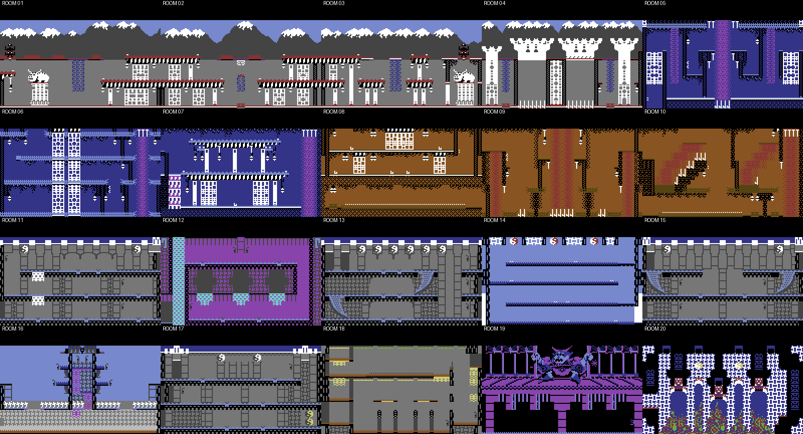

# Rombygging fra C64-kildene

## Nå implementert: kildebasert rommotor og rippede tegn

Brukerens bestilling 24./25. oktober om å bygge alle rom og rippe C64-grafikken er
implementert i `core/c64_rooms.c`. De20 rommene bruker nå den frosne
kandidatens tegn, attributter og romprogrammer. De håndlagde bjelkene,
nettrektanglene og den delte AI-fjellbakgrunnen er tatt ut av kjørekoden.
Figurkunsten er foreløpig de eksisterende Amiga-figurene, omfarget til rompaletten.

- `tools/build_c64_rooms.py` oversetter 2392 nåbare 6502-instruksjoner og dekoder tegnstrengskriveren
  `$17E2–$1817` separat fra
  romdekoderen,20 init-/løprutiner, felles tegnanimasjon og hjelpere til C. Adressene står
  ved hver genererte blokk i `core/c64_room_programs.h`. Koden kompileres til
  68000; spillet inneholder ingen6502-instruksjonstolk.
- 8×16-celler, øvre/nedre tegn, svarte attributter og de ekstra1–2
  dekodercellene beholdes. Tegnsettbankene `$A000/$A800/$B000/$B800` omfatter
 512 bankspesifikke cellegrafikker, også banken brukt ved bossens sluttfase.
- Dører, broer, animerte tegn, fargetilstand, utløste feller og rommenes
  lanternevilkår kommer fra de oversatte grenene. Fire hardkodede åpninger
  styrer ikke lenger rommet. Dørkontakten bruker carry-betingelsene i
  `$30D4–$310B`, ikke en ny DOWN-regel.
- Romgrafikken bruker IRQ-ens fargepekere `$480B` og rasterpekere `$4833` fra
  `$48EA–$49BA`. Originale C64-fargeindekser får en eksplisitt16-fargers OCS-
  representasjon. Dette lover ikke en bestemt analog C64-monitorpalett.
- Kontakten AND-er kildefigurens maske med de faktiske tegnbitene og
  klassifiserer med attributtene. En 8 kB CPU-buffer, pakket kontaktdekning og byteoppslag gjør denne
  operasjonen raskere uten å endre klassifiseringen. Endringer i tegn,
  attributter og tegnsett oppdaterer både kontaktgrunnlag og begge skjermbuffere.
- R19s prosjektiler bruker originalens genererte bitmap, posisjoner,
  X-utvidelse og farger. R20s ventetellere, rundeskifte og nullstilling av
  lanternetabeller er koblet inn. Hub-returen følger `$09F6–$0A0B`.

Produksjonsuttrekket ligger i `assets/c64/rooms-v1/`, med kildehash,
20 initialiserte rombilder, tegnatlas og binære tegn-/romdata. Det endrer ingen
originalfiler. Kildehashen er
`092c50dbc997e301c75c7860a3c84026a93a7aaf543968ae36f1ffa19d0800b8`.
Den valgte urørte1984-utgaven er fortsatt ikke bekreftet.

### Hva kontrollene dekker

`test-c64-rooms.ps1` sammenligner kompilert C med den faktiske6502-koden:
20 init-rutiner, 2560 romløkkekall, 160 kontrollerte kall til
originalens tegnanimasjon og 1860 kontaktpar med hel figur/kropp,
640 dørtilfeller, 20 initialbilder og 40 dynamiske planar-bilder. Romløkkene prøves
både med ordinære lanterner og med alle fjernet. Dette er manipulerte,
repeterbare CPU-fixtures, ikke naturlig gjennomspilling eller VIC-timingfasit.
Se `reference/validation/c64-room-runtime.json`.

`test-core.ps1` kontrollerer integrasjonen:20 ankomster, rett fritt fall,
R02s animerte luke til R06, bevarte lanterner, sluttrom og R19-kontakt.
De eldre rektangeltestene er beholdt som historikk og velges eksplisitt med
`-LegacyBlockout`; deres forventede plattformer beskriver ikke dagens rom.

A500-kontrollen velges med `test-amiga.ps1 -SourceRooms -Disk`. Den besøker
alle20 rom ved testvalg og måler minne, skjermrester, Copper-publisering og
PAL-perioder. Romlasting måles separat. Besøksmasken er ikke et bevis på
naturlig tilgang til hvert rom. Resultatet finnes i
`reference/validation/a500-c64-rooms.json` først når kontrollen har bestått.
Den strenge porten er foreløpig åpen: R14 og sluttrommet overskrider feltbudsjettet.
`test-amiga.ps1 -SourceRooms -CollectFrameDrops -Disk` gjennomfører en separat
inspeksjon av alle rom og lagrer `a500-c64-rooms-diagnostic.json`. Denne
kommandoen registrerer avvik og godkjenner ikke den strenge ytelsesporten.

Full ADF-inspeksjon 25. oktober: 7200 feltiterasjoner, alle20 rom, 39 native
kontroller av rommenes pikseldata uten avvik og ingen romkodefeil. Det var
76 tidsavvik, største oppdateringsavstand var tre PAL-perioder og 327 viste
felt beholdt forrige bilde (lengste serie: to). Største sammenhengende ledige
Chip-blokk var 70 304 byte etter lasting. Romlasting måles separat og tok
opptil 284 PAL-perioder, omtrent5,68 sekunder. Tallene beskriver denne
inspeksjonsruten, ikke en naturlig gjennomspilling.
Framebuffersammenligningen kontrollerer pikselindekser. PNG-forhåndsvisningen
henter sluttrommets dynamiske palettord fra den publiserte Copper-listen;
OCS-fargeregisteret brukes ikke som lesbart register.

### A500-rendering og minne

Den native skjermen har fire interleavede bitplanes: 40 byte per planrad,
160 byte per pikselrad og Copper-modulo 120. Vanlige tegn kopieres fra en
CPU-buffer. Store animerte flater bruker forhåndsberegnede, kildeavledede
blitterrektangler i en 104 KiB Chip-buffer. Det største rommet bruker
104 448 av de 106 496 avsatte bytene. Rå C64-tegn og logisk tilstand ligger separat.

Animeringen i `$2CF1–$2D54` har en direkte dekodet rutine for binærregning
og fase 0–7; den genererte instruksjonsbanen beholdes for andre innganger.
Flytterutinen `$104B–$10B4` og dens tegnskriving i `$404E–$407C` har også
en direkte bane for binærregning. Posisjonstabellene `$010F–$0149`,
omslagsgrensene og streng-ID-ene beholdes. `$2509–$255D` oppdaterer
originalens prioriterte lydkøer i skygge-RAM. Kontrollene sammenligner også
disse køene og SID-registrene; dette er ikke en SID-lydemulator.
De åtte bufferbildene bygges fra originalens `$42F1/$4309`-tabeller.
Før en rektangelbane brukes, må de seks faktiske tegnenes 48 bytes stemme
med fasen. Endrede romceller eller attributter ugyldiggjør den berørte
rektangelbanen. Reservetegningen følger fortsatt de faktiske kildebytesene.
En egen CPU-kontroll kjører den originale 6502-rutinen i alle åtte faser,
sammenligner lav-RAM, stakk, selvmodifiserte operander og tegnbytes, og
kontrollerer hele det interleavede bildet etter både tegn- og blokkoperasjoner.
Hvert lastede roms native pikseldata sammenlignes med de kildebaserte
tegnstemplene før HUD tegnes (`c64_render_checks/mismatches`).

De eksisterende figurene bruker 96 forhåndskonverterte retninger/positurer:
90 912 byte i Chip RAM, 44 042 pakkede byte i programmet og 1664 byte
felles klippescratch. Dette er en deterministisk ompakking av eksisterende
kunst. Masken gjentas i interleavede A/B-par slik at en figur tegnes med én
blitteroperasjon. Korte bakoverreferanser og byte-run-pakking sparer programminne;
pakking/utpakking og alle 96 pixelbilder kontrolleres deterministisk.
Ingen nye figurer, AI-bilder eller lyder er generert i romarbeidet.
Det eksplisitte Chip-budsjettet i kamp-/romtesten er 368 996 byte, inkludert
fire bitmaps, Copper, figurer, animasjonsbuffer, lyd og diagnostisk tone.
CLI-oppstart reserverer nå16 KiB stakk. Den tidligere64 KiB-reservasjonen
etterlot bare3640 byte sammenhengende Chip RAM i den nye testutgaven.
ADF-inspeksjonen kjører med DOS-standardstakk. Kontrollene krever minst
64 KiB sammenhengende Chip etter ADF-lasting og48 KiB ved CLI-oppstart,
som også har CLI-/filsystemkostnader. Dette er eksplisitte reserver utover
de faste DMA-allokeringene, ikke en økning av maskinens512+512 KiB RAM.

Før aktørgjennomgangen i [T01–T18](TEST_AUDIT_2026-10-25.md) fullførte
CLI-kontrollen to6000-felts kampforløp med samme vertstilstander:
66 treff,5 fiendenederlag,10 fiendespawn og2 dødsfall/respawn for Bruce.
Begge gjenopprettet OS og hadde identisk minne før start. Hver kjøring hadde
8 tidsavvik og28 224 byte sammenhengende Chip ledig, under48 KiB-målet.
Testutgaven allokerer i tillegg en40 KiB framebufferkopi; minneavviket må
følges opp med direkte måling av den vanlige utgaven. Den strenge
minneporten er åpen. `a500-c64-combat-diagnostic.json` bevarer de kontrollerte
resultatene og den mislykkede porten; `tools/collect_c64_native_replay.py`
gjør ikke dette til en bestått test.

`c64_rooms.c` kompileres separat med 16-bits `int` på 68000. Alle delte
skalarargumenter er eksplisitte 32-bits `long`, og delte strukturer bruker
faste feltstørrelser. Kontaktbufrene oppdateres bare i områdene som en
spørring trenger; de beholder egne ugyldighetsflagg etter at visuell dirt er
forbrukt. Tegnversjoner følger både kontaktcellene og mellomlagrede spørringer,
slik at tegnanimasjon også ugyldiggjør kontakt uten å gå gjennom hele rommet.
Visuell buffering fastsetter aldri kollisjonsgrunnlaget.
Forekomstindeksen for hyppig endrede tegn følger de faktiske skriverne i
`$40BC–$4132` og `$2CF1–$2D54`. Øvrige tegn får indeksen bygget ved behov
etter celleendringer. Dette utsetter bare indeksen for grafikkoppdatering; de faktiske kildebytesene,
attributtene og kontaktens ugyldighetsflagg oppdateres med én gang.

Den eksisterende adapteren sikter mot ett spillsteg hvert tredje PAL-felt.
Tidsavvik i tunge felt kan forlenge dette; original aktørkadens og stabil
maskinvarekadens for alle rom er ikke godkjent.
Vanlige tegn og to balanserte grupper med kildeavledede animasjonsrektangler
behandles i de to mellomliggende feltene. Hver skjermbuffer kopierer høyst
5000 byte endret bakgrunn per felt.
Bakgrunnsbufferen oppdateres ett til to felt etter den logiske endringen.
Ved store endringer kan oppdateringen av begge skjermbuffere strekke seg
over flere felt. Denne presentasjonsforsinkelsen påvirker ikke kontaktdataene. Begge skjermbuffere får endrede ord, med sammenhengende områder
slått sammen til blitterrektangler. Tegnsettbytte behandles som full romtegning
og måles separat som lasting. Full original aktørtiming er fortsatt åpen.
Hvis arbeidet før figurtegning har brukt opp feltets tegnemargin, beholdes
forrige viste bilde. Dette sparer tegnetid, men kan ikke rette et spillsteg
som alene bruker mer enn ett felt.
Rapportene oppgir `held_image_fields`, `drawn_image_fields` og
`max_held_image_streak`; bestått feltkadens betyr derfor ikke at hvert felt
har et nytt bilde. Dette er en eksplisitt begrensning i presentasjonen.
Detaljprofilering aktiveres med `amiga-build.ps1 -Autotest -SourceProfile`;
den gjør flere CIA-avlesninger per operasjon og brukes til diagnose. Den
ordinære ytelsesporten måler fortsatt PAL-felt, arbeidstid og publisering,
uten denne ekstra komponentprofileringen. Blitteren får prioritet under
spillets maskinvareovertakelse; OS-tilstanden gjenopprettes ved avslutning.

### Åpent etter romporteringen

Hele aktørmotoren er ennå ikke oversatt. Bevegelse, kamp og AI har tidligere
kandidatrutiner. Koblingen bruker kildepose2 som stå-/kontaktmaske; den skal
senere erstattes av originalens komplette posevalg. Retningslåsene for dører
avledes foreløpig av aktørens siste forflytning. Originalens fulle historikk
og forsøk på å komme løs fra svart kontakt gjenstår; nåværende adapter
fører bare tilbake den horisontale forflytningen som traff svart kontakt.

Romfarer velger originalens dødsgren, mens den eksisterende Amiga-motorens
respawnteller fortsatt brukes. SID-kall i romkodens skyggetilstand spiller
ikke original SID-lyd. Hovedløkkens komplette caller-registerkontekst og RNG-rekkefølge er heller
ikke portert; CPU-fixtures starter med eksplisitte adapterregistre.
Tilbakemating av alle aktørtilstander til romkodens spesialgrener, multiplayer, nøyaktig dødstiming, full poeng-/livsvisning og
naturlig gjennomspilling må kontrolleres videre. Dette er derfor ikke full
M4 eller sertifisert originalparitet, selv om alle romprogrammene er oversatt.

Tidligere blokkromsanalyse er bevart i [historikken](history/ROOM_RECONSTRUCTION_BEFORE_RUNTIME.md).
